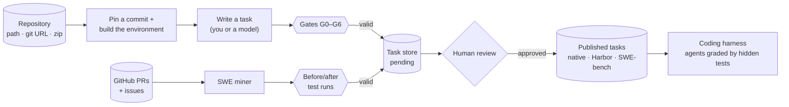

<div align="center">

# Task Factory

**Turn any software repository into validated coding tasks for evaluating AI coding agents.**

[](pyproject.toml)
[](swe/)
[](docs/deployment.md)
[](docs/getting-started.md#install)
[](docs/harness.md#harbor-export)

Innodata AI Hackathon 2026 · Track 1: Coding Task Factory

[Getting started](docs/getting-started.md) ·
[Documentation](docs/README.md) ·
[CLI reference](docs/cli-reference.md)

</div>

---

## Why Task Factory

- **Measuring a coding agent needs good tasks:** a real repository, a clear request, and tests that decide pass or fail.
- **Writing those tasks by hand is slow**, and a weak task (vague request, tests that pass anyway) gives a misleading score.
- **Task Factory automates it** and **proves each task is valid by running code**, so a broken task never reaches a benchmark.

## Features

- **Two ways to create tasks, one package format**
  - **Gated pipeline:** a person or a model writes the task; seven gates prove it valid, including mutation testing.
  - **SWE miner:** turns merged GitHub pull requests that close an issue into SWE-bench style tasks at the exact base commit.
- **Validity is proven, not claimed**
  - Every check runs real tests in fresh, offline Docker containers.
  - The tests must fail without the change, pass with it, and catch deliberately wrong versions of it.
- **Human review is built in**
  - Every valid task waits as `pending`; only approved tasks are published.
  - Deletions need a reason; manual edits are re-validated and disclosed.
- **A coding harness for real agents**
  - Runs the Task Factory engine, Claude Code, Codex, Aider, mini-swe-agent or any command.
  - Grades with hidden tests; every passing solution becomes a git branch.
- **Leak-proof evaluation**
  - The agent's sandbox can reach only the model's API (allowlist proxy); web tools are off.
  - Hidden tests and the reference solution never enter the agent's sandbox.
- **Any language, as data**
  - Languages live in `ecosystems.toml`: Python, JavaScript/TypeScript, Bash, Java, Go, Rust.
- **A terminal for the whole loop**
  - Set up, generate, review, run, compare models, inspect diffs: all from slash commands.
- **Portable and shareable**
  - Exports to [Harbor](https://github.com/laude-institute/harbor) and SWE-bench JSONL.
  - Records go to MongoDB (optional); the whole pipeline runs in containers.

## How it works



- **Each task is a package:** requirements (visible), reference diff (hidden), hidden tests, a pinned Docker environment, validation evidence and checksums.
- **Details:** [Concepts](docs/concepts.md) · [Gated pipeline](docs/gated-pipeline.md) · [SWE miner](docs/swe-miner.md) · [Harness](docs/harness.md)

## Quick start

### Requirements

- Python 3.11+ and [uv](https://docs.astral.sh/uv/)
- Docker (or Podman)
- Optional: Node 22.18+ and the [GitHub CLI](https://cli.github.com) for the SWE miner
- Optional: Bun, to build the Task Factory terminal

### Install

```sh
git clone https://github.com/sreenivasivbieb/task-factory && cd task-factory
uv sync
uv run pytest -m "not docker"    # fast check; drop the marker to run the Docker tests too
```

### Make and run a task (toy repository)

```sh
cp -r tests/fixtures/toy_python_repo /tmp/toyshop
git -C /tmp/toyshop init -q && git -C /tmp/toyshop add -A && git -C /tmp/toyshop commit -qm init

uv run factory load --repo /tmp/toyshop                                  # pin the repository
uv run factory inspect                                                   # build the environment, run the baseline
uv run factory tasks add tests/fixtures/tasks/python/good_bulk_discount  # every gate must pass
uv run factory harness run --agent oracle                                # sanity check: resolves 100%
```

### Mine SWE-bench style tasks from GitHub

```sh
gh auth login
node swe/cli.ts mine https://github.com/pallets/click --max 5
```

### More ways to run

- **Terminal (recommended):** [Getting started → terminal](docs/getting-started.md#use-the-terminal)
- **Containers:** `docker compose up -d mongo` and `scripts/factory-docker …` → [Deployment](docs/deployment.md)

## Common commands

| Goal | Command |
|---|---|
| Pin a repository and build its environment | `factory load --repo SRC` · `factory inspect` |
| Add your own task (all gates run) | `factory tasks new NAME` · `factory tasks add DRAFT` |
| Review tasks | `factory review` · `factory tasks approve|delete|restore ID` |
| Publish approved tasks | `factory tasks publish --out DIR [--format harbor]` |
| Run agents on tasks | `factory harness run --agent AGENT --model PROVIDER/MODEL` |
| Mine tasks from GitHub | `node swe/cli.ts mine URL --max N` |
| Sync records to MongoDB | `factory db sync` |
| Free disk space | `factory images prune [--all]` |

- Full list: [CLI reference](docs/cli-reference.md)
- Terminal slash commands: [Terminal guide](docs/terminal.md)

## Documentation

| Guide | What it covers |
|---|---|
| [Getting started](docs/getting-started.md) | Install, first task, terminal, SWE miner, containers |
| [Concepts](docs/concepts.md) | Tasks, packages, gates, review states, glossary |
| [Gated pipeline](docs/gated-pipeline.md) | Loading, inspection, generation, the seven gates, mutation testing |
| [SWE miner](docs/swe-miner.md) | Mining pull requests, environments, test extraction, quality flags |
| [Coding harness](docs/harness.md) | Agents, models, grading, solution branches, parallel runs, Harbor |
| [Terminal](docs/terminal.md) | Every slash command and page |
| [Security model](docs/security.md) | Isolation, the egress allowlist, leakage checks, open risks |
| [Deployment](docs/deployment.md) | MongoDB records, Docker Compose, disk usage |
| [Configuration](docs/configuration.md) | Every `factory.toml` key and language settings |
| [CLI reference](docs/cli-reference.md) | Every command and option |
| [Architecture](docs/architecture.md) | Modules, data layout, reproducibility, testing |
| [Decisions](docs/decisions.md) | Every design decision and known limitation, as recorded |

## Project status

| Area | State |
|---|---|
| Gated pipeline, review, harness, Harbor export | ✅ Done |
| Terminal (setup → generate → review → run → compare) | ✅ Done |
| SWE miner (Python repositories) | ✅ Done |
| Egress allowlist, MongoDB records, containers | ✅ Done |
| SWE miner for other languages | 🔜 Planned |
| Automatic feature discovery, variation, report | 🔜 Planned (M7–M9) |

- Open issues and limitations: [docs/decisions.md](docs/decisions.md#limitations)

## Acknowledgements

- The terminal engine is a rebranded build of [OpenCode](https://github.com/sst/opencode); its license ships next to the binary as `THIRD-PARTY-LICENSE`.
- Inspired by [SWE-bench](https://www.swebench.com), [SWE-rebench](https://swe-rebench.com) and [Harbor](https://github.com/laude-institute/harbor).
