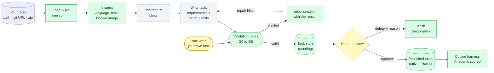
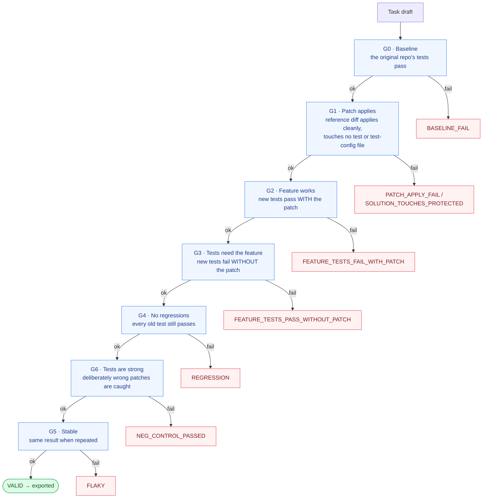
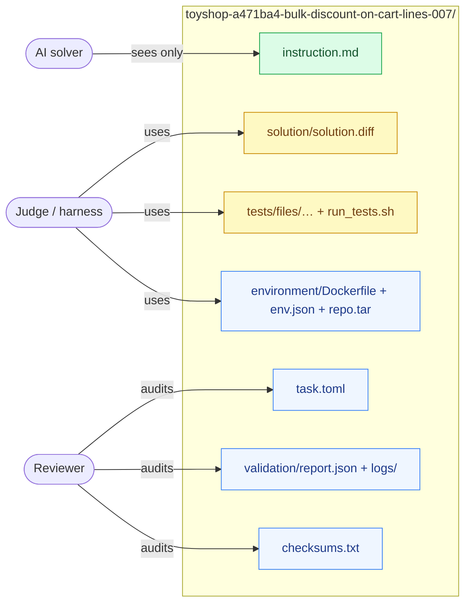
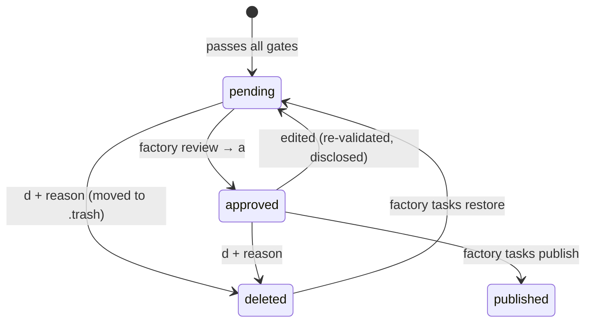
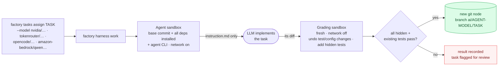
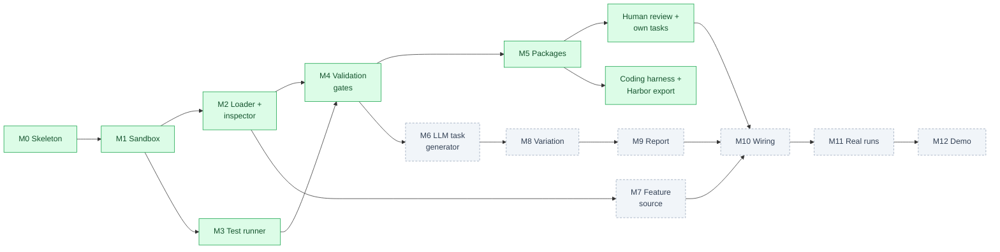

<div align="center">

# task-factory

**Turn any software repository into validated coding tasks for evaluating AI coding systems.**

Innodata AI Hackathon 2026 · Track 1: Coding Task Factory

`Python 3.11+` · `Docker` · `153 tests` · `Harbor-compatible`

</div>

---

## The problem in one paragraph

To find out how good an AI coding agent is, you give it a real repository and a
task ("add a bulk discount to the cart") and check whether its change works.
Writing those tasks by hand is slow, and a task is only useful if it is **fair**:
the requirements must be clear, the hidden tests must really need the new
behaviour, and nothing else in the repo may break. task-factory automates this.
It takes a repository, produces tasks, and **proves each task is valid by
running code**, so a weak or broken task never reaches the benchmark.

## How it works in 60 seconds



<sub>Green = built and tested. Yellow = a person decides. Dashed = next milestones (feature source and LLM task generator).</sub>

1. **Load** copies the repo into a work folder and pins one exact commit (a 40-character SHA). The original is never touched.
2. **Inspect** works out the language, how to install it and how to run its tests, builds a Docker image, and runs the existing test suite once.
3. **Write tasks**: each task has a requirements file, a reference implementation as a diff, and hidden tests. You can write your own today; the LLM generator is the next milestone.
4. **Validate** runs seven gates in fresh, network-less containers. A task passes only if every gate passes, including the ones you write yourself.
5. **Review**: a person looks at every valid task and approves or deletes it. Deletions need a reason and are disclosed.
6. **Publish** only the approved tasks, in our format or in [Harbor](https://github.com/laude-institute/harbor)'s format.
7. **Harness**: assign tasks to a test model (OpenCode with NVIDIA, TokenRouter, OpenCode Zen or AWS Bedrock Qwen; Claude Code; Codex; Aider; mini-swe-agent; or any command). It solves them in a sandbox, the hidden tests grade it, and every passing solution becomes a new git branch.

## What makes a task "valid"

A task is valid only when the tests prove five things. Each gate runs in its own
fresh container. The first gate that fails rejects the task, with an exact code.



G3 is the gate most generators skip: a "feature test" that already passes on
the old code tests nothing. G6 goes further. It breaks the reference patch on
purpose (flips `>=` to `>`, deletes an error branch, hard-codes the expected
value…) and demands that the hidden tests notice. If a wrong patch still passes,
the tests are too weak and the task is rejected.

**Which areas fit?** Anything whose behaviour a test can check. One task per area
was written for the toy repo and passed every gate with 10 repeats and all six
mutation operators: a **security** fix (receipt line injection + a SKU
allowlist; an AI model solved it), a **scalability** change (a tag index whose
cost stays flat from 1k to 100k products, measured as a timing ratio so it holds
on any machine) and an **API design** task (pluggable coupon rules). Out of
reach: things that need a live network or many machines, pure refactors (G3
needs a failing test) and visual or architecture design (needs a judge, not a
test). Details in [design §9](docs/design.md#what-kinds-of-tasks-fit).

## A real example, end to end

The bundled toy repo `toyshop` is a tiny shop library. One task asks for a bulk
discount. Here is what the factory produces and checks.

<table>
<tr><th>Requirements (visible to the solver)</th><th>Reference patch (hidden)</th></tr>
<tr valign="top"><td>

> Change `toyshop.pricing.line_total(price_cents, qty)` so that a cart line
> with **10 or more** items gets **10% off** that line.
>
> - Below 10 items the line total is unchanged.
> - The 10% is rounded half up to a whole cent.
> - `subtotal(cart)` and everything built on it use the discounted totals.

</td><td>

```diff
+BULK_MIN_QTY = 10
+BULK_PERCENT = 10

 def line_total(price_cents, qty):
-    return price_cents * qty
+    amount = price_cents * qty
+    if qty >= BULK_MIN_QTY:
+        amount -= (amount * BULK_PERCENT + 50) // 100
+    return amount
```

</td></tr>
<tr><th>Hidden test (one of three)</th><th>Why G6 matters</th></tr>
<tr valign="top"><td>

```python
def test_bulk_discount_boundary():
    assert line_total(100, 9) == 900
    assert line_total(100, 10) == 900
```

</td><td>

The mutant `if qty > BULK_MIN_QTY:` looks right but
is off by one. With 10 items it gives `1000`, so the
boundary test fails and the mutant is **caught**. A
test that only checked 20 items would let it through,
and that task would be rejected with
`NEG_CONTROL_PASSED`.

</td></tr>
</table>

The fixture set has one good task and one deliberately broken task per reject
code. Running them gives exactly the expected verdicts:

```text
$ factory validate --tasks tests/fixtures/tasks/python
rejected  FEATURE_TESTS_FAIL_WITH_PATCH      toyshop-a471ba4-bulk-discount-wrong-threshold-001
rejected  FLAKY                              toyshop-a471ba4-bulk-discount-flaky-test-002
rejected  FEATURE_TESTS_PASS_WITHOUT_PATCH   toyshop-a471ba4-bulk-discount-tests-check-old-be-003
rejected  PATCH_APPLY_FAIL                   toyshop-a471ba4-bulk-discount-stale-patch-004
rejected  REGRESSION                         toyshop-a471ba4-bulk-discount-breaks-money-forma-005
rejected  SOLUTION_TOUCHES_PROTECTED         toyshop-a471ba4-bulk-discount-reference-also-edi-006
rejected  NEG_CONTROL_PASSED                 toyshop-a471ba4-bulk-discount-weak-tests-007
valid                                        toyshop-a471ba4-bulk-discount-on-cart-lines-008
1/8 valid
```

The same set exists for a Node.js repo (`textkit`), with the same results.

## What a task package looks like



| File | What it holds | Who sees it |
| --- | --- | --- |
| `instruction.md` | The requirements | the solver (nothing else) |
| `task.toml` | Repo, pinned commit, test IDs (`fail_to_pass`, `pass_to_pass`), tags, validation summary | judge |
| `solution/solution.diff` | Reference implementation | hidden |
| `tests/` | Hidden feature tests and a script that runs them | hidden |
| `environment/` | Dockerfile, config and `repo.tar` (the pinned commit): `docker build environment/` rebuilds the exact sandbox on any machine, base image pinned by digest | judge |
| `validation/` | Gate-by-gate report and the raw logs of every run | reviewer |
| `checksums.txt` | SHA-256 of every task file; one changed byte fails verification | reviewer |

`factory validate --tasks <package>` rebuilds everything from these files and
runs all gates again, so the evidence can be checked by someone who never saw
the original run, and without access to the original repo.

## Human in the loop

Automatic checks prove a task is *valid*. Only a person can say it is *good*:
clear wording, a realistic change, worth an agent's time. So every valid task
lands in a **task store** as `pending`, and nothing is published until a
reviewer approves it.



Review one task at a time in the terminal:

```text
$ factory review
1 pending task(s) to review · reviewer: you
──────────────────────────────── task 1/1 ────────────────────────────────
╭──────────── toyshop-a471ba4-bulk-discount-on-cart-lines-007 ────────────╮
│ status       pending                                                    │
│ repo         toyshop @ a471ba47d091  (python)                           │
│ kind / tags  feature  ·  validation rule, data transformation           │
│ touches      toyshop/pricing.py                                         │
│ tests        3 fail_to_pass · 28 pass_to_pass                           │
│ mutants      2/2 caught (score 1.0)                                     │
│ gates         G0   G1   G2   G3   G4   G6   G5                          │
╰─────────────────────────────────────────────────────────────────────────╯
╭─────────── instruction.md  (the only file the solver sees) ────────────╮
│ Bulk discount on cart lines …                                           │
╰─────────────────────────────────────────────────────────────────────────╯
a=approve  d=delete  s=skip  i=instruction  p=patch  t=tests  g=gates  e=edit  q=quit
choice>
```

| You want to… | Command |
| --- | --- |
| See every task and its status | `factory tasks list [--status pending]` |
| Read one task (summary, instruction, colored diff, tests, gate logs) | `factory tasks show TASK_ID [--section patch]` |
| Step through pending tasks and decide | `factory review` |
| Approve | `factory tasks approve TASK_ID [--note "…"]` |
| Delete (soft, reason required) | `factory tasks delete TASK_ID --reason "requirements are vague"` |
| Undo a delete | `factory tasks restore TASK_ID` |
| Fix a task by hand | `factory tasks edit TASK_ID` then `--apply --reason "…"` (re-validated, marked as a manual edit) |
| Write your own task | `factory tasks new my-task`, fill it in, `factory tasks add workdir/drafts/my-task` |
| Publish approved tasks | `factory tasks publish --out submission/ [--format harbor]` |
| See what humans changed | `factory tasks summary` (counts, deletions with reasons, manual edits) |

Every decision is appended to `tasks/.review/log.jsonl` with who, when and why.
`publish` writes `review_summary.json` next to the tasks, so deletions and manual
edits are disclosed, as the organizers require. A task you write yourself goes
through all seven gates like any other and is marked `human (your name)`.

## Coding harness

The harness answers the question the tasks exist for: *how well does this
model do?* You assign a task to a test model; a worker gives the model a fresh
sandbox at the repo's base commit with every package requirement already
installed, lets it implement the task, then runs the hidden tests. **If every
test passes, the model's solution becomes a new git node**: a commit on its own
branch.



### Assign a task to a test model and run it

```sh
factory tasks assign TASK_ID --agent opencode --model opencode/deepseek-v4.1-flash-free
factory tasks assignments                    # what is waiting
factory harness work --use-host-auth         # run every open assignment
factory tasks assignments --all              # results, with the branch of each passing solution
git -C workdir/solutions/toyshop log --oneline --all
```

A real run on the toy task, with a free model through OpenCode:

```text
$ factory harness work --use-host-auth
opencode · opencode/deepseek-v4.1-flash-free: 1 task(s), k=1
  resolved         toyshop-a471ba4-bulk-discount-on-cart-lines-007 (attempt 1, agent 27.75s)
      new branch ai/opencode-deepseek-v4-1-flash-free/toyshop-a471ba4-bulk-discount-on-cart-lines-007 @ 5c7b3ce3f7f4
  resolved@1: 100%
```

The new commit carries the evidence in its message:

```text
Bulk discount on cart lines: solved by opencode (opencode/deepseek-v4.1-flash-free)

Task: toyshop-a471ba4-bulk-discount-on-cart-lines-007
Base commit: a471ba47d0913375f9bcbb3b7557bca97f39c881
Agent: opencode · Model: opencode/deepseek-v4.1-flash-free · Attempt 1
Hidden tests: 3/3 fail_to_pass passed, 28/28 pass_to_pass passed
```

In that run the model also edited an existing test file (it added its own
tests). The harness put that file back before grading, recorded it under
`tests_tampered`, and committed only the source change to the branch.

### Which models

[OpenCode](https://github.com/sst/opencode) is the default agent because it talks
to many providers with one CLI. Pass the model as `provider/model`:

| Provider | Example `--model` | Credentials |
| --- | --- | --- |
| OpenCode Zen (has free models) | `opencode/deepseek-v4.1-flash-free`, `opencode/qwen3.6-plus` | `opencode auth login`, or `OPENCODE_API_KEY` |
| NVIDIA (build.nvidia.com, free credits) | `nvidia/<model id from opencode models nvidia>` | `opencode auth login`, or `NVIDIA_API_KEY` |
| TokenRouter | `tokenrouter/<model id>` | `opencode auth login`, or `TOKENROUTER_API_KEY` |
| AWS Bedrock (Qwen) | `amazon-bedrock/qwen.qwen3-coder-480b-a35b-v1:0` | `AWS_ACCESS_KEY_ID` + `AWS_SECRET_ACCESS_KEY` + `AWS_REGION`, or `AWS_BEARER_TOKEN_BEDROCK` |

`--use-host-auth` copies **only the login for the model's provider** from your
OpenCode `auth.json` into the sandbox (through stdin, never a command line);
the container is removed after the attempt. Without it, the harness forwards
the provider's environment variables instead. Run `opencode models` to see the
exact model IDs your accounts can use: in our test, two IDs listed by the
catalogue were rejected by the provider with "model not found", which the
harness reports as `agent_error`.

### Other commands and agents

```sh
factory harness agents                                   # list agents
factory harness run --agent oracle                       # sanity check: must resolve 100%
factory harness run --agent noop                         # sanity check: must resolve 0%
factory harness run --agent opencode --model … --k 3     # without assignments: all tasks in the store
factory harness run --agent command --cmd 'my-agent --task-file {instruction_file}'
```

| Agent | What it runs | State |
| --- | --- | --- |
| `opencode` | `opencode run --auto --standalone -m <model>` ([repo](https://github.com/sst/opencode), `@opencode/cli` 2.3.2) | **verified with a real model** |
| `oracle` | applies the reference patch | verified |
| `noop` | changes nothing | verified |
| `command` | any shell command you give it | verified |
| `claude-code` | `claude -p … --output-format json` ([repo](https://github.com/anthropics/claude-code)) | preset, not yet run with a real key |
| `codex` | `codex exec …` ([repo](https://github.com/openai/codex)) | preset, not yet run with a real key |
| `aider` | `aider --message-file …` ([repo](https://github.com/Aider-AI/aider)) | preset, not yet run with a real key |
| `mini-swe-agent` | `mini -y --exit-immediately …`, LiteLLM models such as `bedrock/qwen…` ([repo](https://github.com/SWE-agent/mini-swe-agent)) | preset, not yet run with a real key |
| your own | `[harness.agents.NAME]` in `factory.toml` | |

Each attempt is graded into one category: `resolved`, `wrong_behaviour`,
`regression`, `build_error`, `no_change`, `agent_error` (the agent failed, for
example a bad model ID), `timeout` or `patch_apply_fail`. The summary reports
**resolved@k**, pass rate, time and cost (when the agent reports it), and a
difficulty per task: *easy* (every attempt solved it), *medium* (some) or
*unsolved*. An unsolved task gets a note in the review log, because it may be
unsolvable and deserves a human look.

A failure of the *setup* is not a verdict on the task. If every attempt ends in
`agent_error` (an exhausted free quota, a wrong model ID, a missing key), the
task's difficulty is *error*, no "unsolved" note is written, and `harness work`
leaves the assignment open to retry. A run stops after two agent errors in a
row instead of failing every remaining task the same way.

**Cheating is blocked.** The agent's sandbox never contains the hidden tests or
the reference solution (checked before the agent starts). API keys never
appear on a command line or in logs. Before grading, every change the agent made
to tests or to files that steer the test run (`conftest.py`, `pytest.ini`,
`pyproject.toml`, `package.json`, jest/vitest config, …) is undone: edited and
deleted files are restored, new ones removed. A review found that a six-line
`conftest.py` marking every test "passed" used to count as a solution; it is now
caught by our harness and by the Harbor verifier, and tests keep it that way.

### Harbor compatibility

[Harbor](https://github.com/laude-institute/harbor) (Apache-2.0, from the
Terminal-Bench team) is a popular framework for running agents on tasks.
`factory tasks publish --format harbor` writes each task in Harbor's layout
(`environment/` with the pinned repo, `solution/solve.sh`, `tests/test.sh`
writing `/logs/verifier/reward.txt`), so the same tasks run on Harbor's built-in
agents too. The verifier gives reward 1 only when every hidden test actually ran
and passed and the full suite passes. Checked with the real Harbor CLI:

```text
$ harbor run -p submission/ -a oracle        $ harbor run -p submission/ -a nop
  Trials 1 · Exceptions 0 · Mean 1.000         Trials 1 · Exceptions 0 · Mean 0.000
```

## Quickstart

You need Python 3.11+, [uv](https://docs.astral.sh/uv/) and Docker (Podman works too).

```sh
git clone https://github.com/sreenivasivbieb/task-factory && cd task-factory
uv sync
uv run pytest                      # 153 tests; Docker tests skip with a message if Docker is missing
```

Run the whole flow on the bundled toy repo:

```sh
cp -r tests/fixtures/toy_python_repo /tmp/toyshop
git -C /tmp/toyshop init -q && git -C /tmp/toyshop add -A && git -C /tmp/toyshop commit -qm init

uv run factory load --repo /tmp/toyshop            # copy and pin the repo
uv run factory inspect                             # detect env, build image, run baseline (28 passed)
uv run factory validate --tasks tests/fixtures/tasks/python   # 1/8 valid, 7 rejected with exact codes
uv run factory export                              # valid tasks go to workdir/tasks as pending
uv run factory review                              # approve or delete them, one by one
uv run factory tasks publish --out submission/     # only approved tasks
uv run factory validate --tasks submission/        # re-verify the packages from disk alone
uv run factory harness run --agent oracle          # harness sanity check: 100% resolved
```

## Commands

| Command | What it does | State |
| --- | --- | --- |
| `factory load --repo SRC [--commit SHA]` | Copy and pin the repo; writes `repo_spec.json` | ✅ |
| `factory inspect` | Detect environment, build image, run baseline; writes `env_config.json` | ✅ |
| `factory validate --tasks DIR` | Run the gates on task drafts or re-verify packages | ✅ |
| `factory export` | Write every valid task into the task store as `pending` (never overwrites a package already there; `--force` does) | ✅ |
| `factory tasks list · show · approve · delete · restore · edit · new · add · publish · summary` | Human review and authoring | ✅ |
| `factory review` | Interactive review, one task at a time | ✅ |
| `factory tasks assign · unassign · assignments` | Assign tasks to a test model | ✅ |
| `factory harness agents · run · work` (alias `factory bench`) | Run AI coding agents on tasks, score them, branch passing solutions | ✅ |
| `factory ideas` · `generate` · `report` · `run` | Ideas mined from the repo (TODO/FIXME, stubs, skipped tests, bug-fix history), LLM generation, evidence report, one-shot pipeline | 🔜 M6–M10 (labelled "planned" in `--help`) |

Flags on every command: `--workdir`, `--config`, `--seed`, `--force`, `--dry-run`,
`--verbose`, `--backend docker|local`. Each step saves JSON under `workdir/` and
skips work that is already done, so a run can be stopped and resumed.

Exit codes: `0` success · `1` pipeline failure · `2` bad usage or config ·
`3` environment problem (for example Docker missing) · `4` ran but no valid tasks.

## Supported languages

| Language | Detected from | Test runner | State |
| --- | --- | --- | --- |
| Python | `pyproject.toml`, `setup.py`, `requirements.txt` | pytest (also runs unittest suites) | end to end |
| JavaScript / TypeScript | `package.json` | node:test, Jest, Vitest | end to end (node:test) |
| Java | `pom.xml`, `build.gradle` | Maven Surefire, Gradle | report parser only |
| Go | `go.mod` | `go test -json` | report parser only |
| Rust | `Cargo.toml` | `cargo test` | report parser only |

Adding a language means adding one inspector rule and, if needed, one report parser.

## Progress



The coding harness was planned as an optional extra in M12; it was pulled
forward because it shows whether the tasks are fair (the oracle must score
100%, an empty agent 0%) and lets people review tasks with real agent results.

## Learn more

- **[docs/design.md](docs/design.md)**: architecture, data flow, every component, how the gates and mutants work, and the reasoning behind them.
- **[docs/decisions.md](docs/decisions.md)**: every assumption, deviation and known limitation, recorded as the build went.

## Dependencies and licenses

| Dependency | Used for | License |
| --- | --- | --- |
| pydantic | data models | MIT |
| rich | terminal review screens and tables | MIT |
| pytest (dev only) | tests | MIT |
| hatchling (build only) | packaging | MIT |

Everything else (CLI, TOML writer, report parsers, mutation engine, harness) uses only the Python standard library.
Agents and Harbor are optional external tools: they are installed into sandboxes or run by you, never
imported. Their licenses: Harbor Apache-2.0, Aider Apache-2.0, mini-swe-agent MIT, Codex CLI Apache-2.0,
Claude Code under Anthropic's terms.
