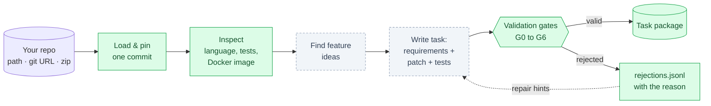
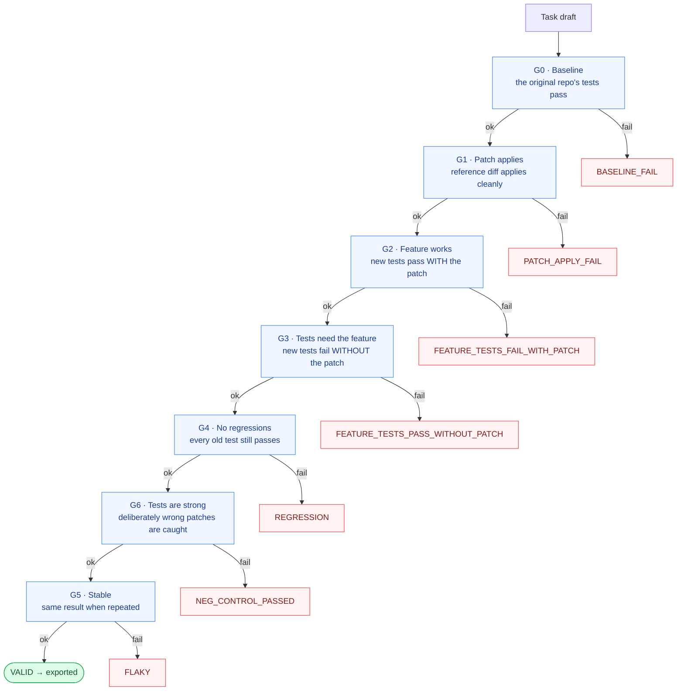
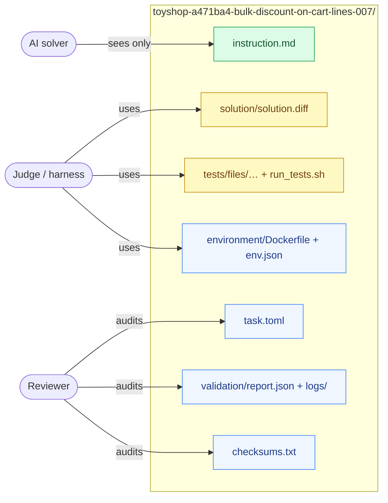
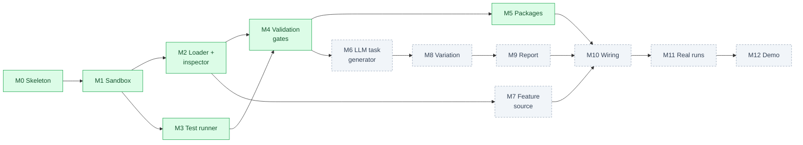

<div align="center">

# task-factory

**Turn any software repository into validated coding tasks for evaluating AI coding systems.**

Innodata AI Hackathon 2026 · Track 1: Coding Task Factory

`Python 3.11+` · `Docker` · `106 tests` · `MIT`

</div>

---

## The problem in one paragraph

To find out how good an AI coding agent is, you give it a real repository and a
task ("add a bulk discount to the cart") and check whether its change works.
Writing those tasks by hand is slow, and a task is only useful if it is **fair**:
the requirements must be clear, the hidden tests must really need the new
behaviour, and nothing else in the repo may break. task-factory automates this.
It takes a repository, produces tasks, and **proves each task is valid by
running code**, so a weak or broken task never reaches the benchmark.

## How it works in 60 seconds



<sub>Green = built and tested. Dashed = next milestones (feature source and LLM task generator).</sub>

1. **Load** copies the repo into a work folder and pins one exact commit (a 40-character SHA). The original is never touched.
2. **Inspect** works out the language, how to install it and how to run its tests, builds a Docker image, and runs the existing test suite once.
3. **Find ideas and write tasks** (next milestone): each task has a requirements file, a reference implementation as a diff, and hidden tests.
4. **Validate** runs seven gates in fresh, network-less containers. A task passes only if every gate passes.
5. **Package** writes each valid task to a folder that anyone can re-verify later from the files alone.

## What makes a task "valid"

A task is valid only when the tests prove five things. Each gate runs in its own
fresh container. The first gate that fails rejects the task, with an exact code.



G3 is the gate most generators skip: a "feature test" that already passes on
the old code tests nothing. G6 goes further. It breaks the reference patch on
purpose (flips `>=` to `>`, deletes an error branch, hard-codes the expected
value…) and demands that the hidden tests notice. If a wrong patch still passes,
the tests are too weak and the task is rejected.

## A real example, end to end

The bundled toy repo `toyshop` is a tiny shop library. One task asks for a bulk
discount. Here is what the factory produces and checks.

<table>
<tr><th>Requirements (visible to the solver)</th><th>Reference patch (hidden)</th></tr>
<tr valign="top"><td>

> Change `toyshop.pricing.line_total(price_cents, qty)` so that a cart line
> with **10 or more** items gets **10% off** that line.
>
> - Below 10 items the line total is unchanged.
> - The 10% is rounded half up to a whole cent.
> - `subtotal(cart)` and everything built on it use the discounted totals.

</td><td>

```diff
+BULK_MIN_QTY = 10
+BULK_PERCENT = 10

 def line_total(price_cents, qty):
-    return price_cents * qty
+    amount = price_cents * qty
+    if qty >= BULK_MIN_QTY:
+        amount -= (amount * BULK_PERCENT + 50) // 100
+    return amount
```

</td></tr>
<tr><th>Hidden test (one of three)</th><th>Why G6 matters</th></tr>
<tr valign="top"><td>

```python
def test_bulk_discount_boundary():
    assert line_total(100, 9) == 900
    assert line_total(100, 10) == 900
```

</td><td>

The mutant `if qty > BULK_MIN_QTY:` looks right but
is off by one. With 10 items it gives `1000`, so the
boundary test fails and the mutant is **caught**. A
test that only checked 20 items would let it through,
and that task would be rejected with
`NEG_CONTROL_PASSED`.

</td></tr>
</table>

The fixture set has one good task and one deliberately broken task per reject
code. Running them gives exactly the expected verdicts:

```text
$ factory validate --tasks tests/fixtures/tasks/python
rejected  FEATURE_TESTS_FAIL_WITH_PATCH      toyshop-a471ba4-bulk-discount-wrong-threshold-001
rejected  FLAKY                              toyshop-a471ba4-bulk-discount-flaky-test-002
rejected  FEATURE_TESTS_PASS_WITHOUT_PATCH   toyshop-a471ba4-bulk-discount-tests-check-old-be-003
rejected  PATCH_APPLY_FAIL                   toyshop-a471ba4-bulk-discount-stale-patch-004
rejected  REGRESSION                         toyshop-a471ba4-bulk-discount-breaks-money-forma-005
rejected  NEG_CONTROL_PASSED                 toyshop-a471ba4-bulk-discount-weak-tests-006
valid                                        toyshop-a471ba4-bulk-discount-on-cart-lines-007
1/7 valid
```

The same set exists for a Node.js repo (`textkit`), with the same results.

## What a task package looks like



| File | What it holds | Who sees it |
| --- | --- | --- |
| `instruction.md` | The requirements | the solver (nothing else) |
| `task.toml` | Repo, pinned commit, test IDs (`fail_to_pass`, `pass_to_pass`), tags, validation summary | judge |
| `solution/solution.diff` | Reference implementation | hidden |
| `tests/` | Hidden feature tests and a script that runs them | hidden |
| `environment/` | Dockerfile and config to rebuild the exact sandbox | judge |
| `validation/` | Gate-by-gate report and the raw logs of every run | reviewer |
| `checksums.txt` | SHA-256 of every task file; one changed byte fails verification | reviewer |

`factory validate --tasks <package>` rebuilds everything from these files and
runs all gates again, so the evidence can be checked by someone who never saw
the original run.

## Quickstart

You need Python 3.11+, [uv](https://docs.astral.sh/uv/) and Docker (Podman works too).

```sh
git clone https://github.com/sreenivasivbieb/task-factory && cd task-factory
uv sync
uv run pytest                      # 106 tests; Docker tests skip with a message if Docker is missing
```

Run the whole flow on the bundled toy repo:

```sh
cp -r tests/fixtures/toy_python_repo /tmp/toyshop
git -C /tmp/toyshop init -q && git -C /tmp/toyshop add -A && git -C /tmp/toyshop commit -qm init

uv run factory load --repo /tmp/toyshop            # copy and pin the repo
uv run factory inspect                             # detect env, build image, run baseline (28 passed)
uv run factory validate --tasks tests/fixtures/tasks/python   # 1/7 valid, 6 rejected with exact codes
uv run factory export --out tasks/                 # write the valid task as a package
uv run factory validate --tasks tasks/             # re-verify the package from disk alone
```

## Commands

| Command | What it does | State |
| --- | --- | --- |
| `factory load --repo SRC [--commit SHA]` | Copy and pin the repo; writes `repo_spec.json` | ✅ |
| `factory inspect` | Detect environment, build image, run baseline; writes `env_config.json` | ✅ |
| `factory validate --tasks DIR` | Run the gates on task drafts or re-verify packages | ✅ |
| `factory export --out DIR` | Write every valid task as a package | ✅ |
| `factory ideas` · `generate` · `report` · `bench` · `run` | Feature source, LLM generation, evidence report, solver benchmark, one-shot pipeline | 🔜 M6–M12 |

Flags on every command: `--workdir`, `--config`, `--seed`, `--force`, `--dry-run`,
`--verbose`, `--backend docker|local`. Each step saves JSON under `workdir/` and
skips work that is already done, so a run can be stopped and resumed.

Exit codes: `0` success · `1` pipeline failure · `2` bad usage or config ·
`3` environment problem (for example Docker missing) · `4` ran but no valid tasks.

## Supported languages

| Language | Detected from | Test runner | State |
| --- | --- | --- | --- |
| Python | `pyproject.toml`, `setup.py`, `requirements.txt` | pytest (also runs unittest suites) | end to end |
| JavaScript / TypeScript | `package.json` | node:test, Jest, Vitest | end to end (node:test) |
| Java | `pom.xml`, `build.gradle` | Maven Surefire, Gradle | report parser only |
| Go | `go.mod` | `go test -json` | report parser only |
| Rust | `Cargo.toml` | `cargo test` | report parser only |

Adding a language means adding one inspector rule and, if needed, one report parser.

## Progress



## Learn more

- **[docs/design.md](docs/design.md)**: architecture, data flow, every component, how the gates and mutants work, and the reasoning behind them.
- **[docs/decisions.md](docs/decisions.md)**: every assumption, deviation and known limitation, recorded as the build went.

## Dependencies and licenses

| Dependency | Used for | License |
| --- | --- | --- |
| pydantic | data models | MIT |
| pytest (dev only) | tests | MIT |
| hatchling (build only) | packaging | MIT |

Everything else (CLI, TOML writer, report parsers, mutation engine) uses only the Python standard library.
