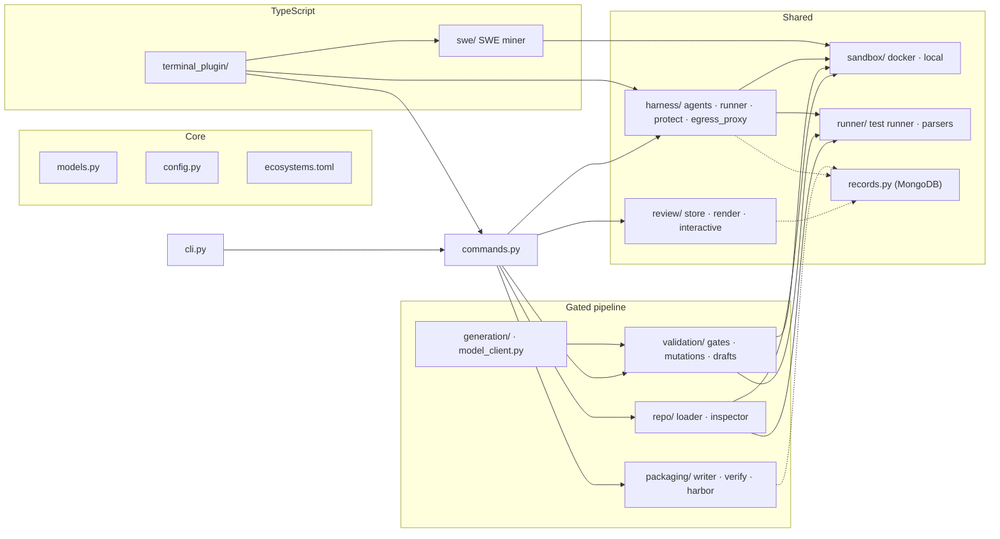
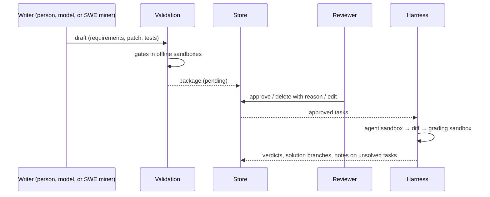

# Architecture

## Design principles

- **Only executed tests decide validity.** Models may write requirements, patches and tests; the verdict comes from running them.
- **Every step is a function of files.** Each command reads JSON from the work folder and writes JSON back; runs can be stopped, resumed and inspected.
- **Machines prove validity, people decide quality.** Gates make a broken task impossible to export; a reviewer makes a dull or unclear one impossible to publish.
- **Nothing language-specific in code.** Languages, test runners and protected files are data.
- **One package format.** Every way of making tasks produces the same package, so every consumer works unchanged.
- **Anything undecided sits behind one module.** The package layout, the model provider and the storage of records can each be swapped in one place.

## Components



| Module | Responsibility |
|---|---|
| `cli.py`, `commands.py` | Argument parsing; one handler per command; no business logic in the CLI |
| `config.py` | `factory.toml` + flags; unknown keys rejected |
| `models.py` | All shared data models (pydantic) |
| `ecosystems.toml`, `ecosystems.py` | Languages as data |
| `repo/` | Copy and pin a repository; detect its environment |
| `sandbox/` | Isolated execution: images, containers, limits, egress proxy, file volumes |
| `runner/` | Run tests and parse reports into stable test IDs |
| `validation/` | The eight gates (`gates.py`), the mutation engine (`mutations.py`), spec coverage G7 (`spec_check.py`) |
| `pipeline.py` | `factory pipeline FILE`: every repository → gates → self-test → publish → oracle/noop → benchmark → report |
| `evidence.py` | `factory evidence`: `REPORT.md`, validation matrix, diversity statistics, leaderboard, failure modes |
| `mcp_server.py` | `factory-mcp`: the MCP server that lets Claude Code operate the factory ([guide](mcp.md)) |
| `reference/` | Reference-guided pipeline (`factory run`, v2.2): profiler, scout, research agents (parallel lanes), critic + example runner, spec writer, builder (single model or panel) with repair routing, Harbor validator, benchmark queue, MongoDB state, snapshots, report |
| `generation/`, `model_client.py` | Model-generated task drafts (v1 `produce`, kept for the A/B comparison) |
| `packaging/` | Write, checksum, verify and export packages |
| `review/` | Task store, review log, assignments, interactive review |
| `harness/` | Agents, attempts, grading, cheat protection, solution branches, egress proxy |
| `records.py` | MongoDB dual write and sync |
| `terminal*.py` | Terminal launcher and its Python bridge |
| `terminal_plugin/` | Terminal commands, pages and sidebar (TypeScript) |
| `swe/` | SWE miner (TypeScript, Node built-ins only) |

- Rules the code follows:
  - Components pass the models from `models.py`, never raw dictionaries.
  - Errors are typed (`BuildError`, `SandboxStartError`, `PackageError`, …) and mapped to exit codes; no silent retries.
  - No provider-specific model code outside `model_client.py` and the terminal engine.
  - The TypeScript miner writes files byte-identical to the Python side (checked by `tests/test_swe_parity.py`).

## Data layout

```
<work folder>/
├── repo_spec.json, env_config.json, inspect.json   Pinned repository and environment
├── drafts/, edits/                                 Task drafts being written or edited
├── runs/<task_id>/                                 Gate reports and logs
├── rejections.jsonl                                Rejected drafts with reasons
├── tasks/<task_id>/                                Packages
├── tasks/.review/log.jsonl                         Review decisions and assignments
├── tasks/.trash/                                   Deleted packages
├── harness/<run_id>/                               results.jsonl, summary.json
│   └── <task_id>/attempt-N/                        agent.log.json, agent.diff, solution.diff,
│                                                   grade-*.json, egress-blocked.txt
├── solutions/<repo>/                               Git repository with solution branches
├── generations.jsonl                               /generate-task history
└── session-runs.jsonl, session-tasks.jsonl         Terminal session links
```

- Terminal projects use `~/.local/state/task-factory/projects/<repo>-<hash>/`.
- SWE stores use `~/.local/state/task-factory/swe/<owner>-<repo>/` and add `repo/`, `prs/`, `mined.json`, `swe-bench.jsonl`.
- Package layout: [Concepts](concepts.md#task-package).

## Life of a task



## Reproducibility

| Source of variation | How it is pinned |
|---|---|
| Repository content | Full commit SHA; synthetic history uses a fixed author and date |
| Environment | Base image pinned by digest; image tag = hash of commit, base image, setup commands, prelude version |
| SWE dependencies | `uv --exclude-newer <merge date>` |
| Runtime | Fixed `TZ`, `LANG`, `PYTHONHASHSEED`; no network |
| Test identity | Stable string IDs from machine-readable reports |
| Task identity | Deterministic `task_id` |
| Package content | Deterministic files and checksums (timings live outside the checksum) |
| Records | Deterministic MongoDB `_id`s |

## How it is tested

- 197 tests: `uv run pytest` (Python) and `node --test tests/ts` (TypeScript, also run by pytest).
- Fixtures:

| Fixture | Contents |
|---|---|
| `toy_python_repo` (toyshop) | 6 modules, 28 tests incl. one slow and one switchable flaky test |
| `toy_node_repo` (textkit) | 4 modules, 22 node:test tests |
| `toy_bash_repo` | A language defined only in `factory.toml` |
| `tasks/python`, `tasks/node` | One good task and one broken task per reject code |
| `reports/` | Sample JUnit, Jest, Go and Cargo reports |

- Coverage highlights:
  - Every gate and reject code, per language.
  - Review flow, human-authored tasks, edits that are re-validated or refused.
  - Harness: oracle 100%, noop 0%, cheating `conftest.py` undone, hidden files absent from the agent sandbox.
  - Egress: only allowed hosts reachable, no route around the proxy, refusals recorded.
  - Engine mounted read-only from a volume.
  - MongoDB: off without a URI, a dead server never stops the pipeline, idempotent sync, live review events.
  - SWE miner: candidate rules, split at the merge-base, test extraction, quality flags, `python_files`, and byte-for-byte parity with the Python formats.
- Docker tests are marked `docker` and skip with a message when Docker is missing.

## Extending

| You want to… | Change |
|---|---|
| Support a new language | `[ecosystems.NAME]` in `factory.toml`; code only for a new report format (`runner/parsers/`) |
| Use another package template | `packaging/writer.py` and `packaging/verify.py`; nothing else knows the layout |
| Use Podman | `sandbox.docker_binary = "podman"` |
| Tune strictness | `gates.mutations`, `gates.stability_repeats`, `gates.max_known_failure_ratio` |
| Fix a detection mistake | `[env]` overrides in `factory.toml` |
| Add a model provider | `model_client.py`, or `/connect` in the terminal; add its host to `harness.allowed_hosts` |
| Benchmark another agent | `[harness.agents.NAME]`, or `--agent command --cmd …` |
| Run on Harbor's agents | `factory tasks publish --format harbor`, then `harbor run -p DIR -a AGENT` |

## Roadmap

| Milestone | Adds | State |
|---|---|---|
| M0–M5 | Sandbox, loader, inspector, test runner, gates, packages | ✅ |
| Review, harness, Harbor | Human review, coding harness, Harbor export | ✅ |
| M6 | Model-generated tasks (`/generate-task`) | ✅ (prompt-driven) |
| SWE miner | Tasks from GitHub history | ✅ (Python) |
| M7 | Feature source: ideas from docs, TODOs, issues, history | 🔜 |
| M8 | Variation report: tiers, tags, multi-file share, near-duplicate check | ✅ (reported; generation-time balancing 🔜) |
| M9 | Evidence report (`factory evidence`) | ✅ |
| M10 | One-command orchestration (`factory pipeline`) | ✅ |
| M11 | G7 spec coverage, semantic mutation operators, gate self-test | ✅ |
| M12 | MCP server for Claude Code | ✅ |
