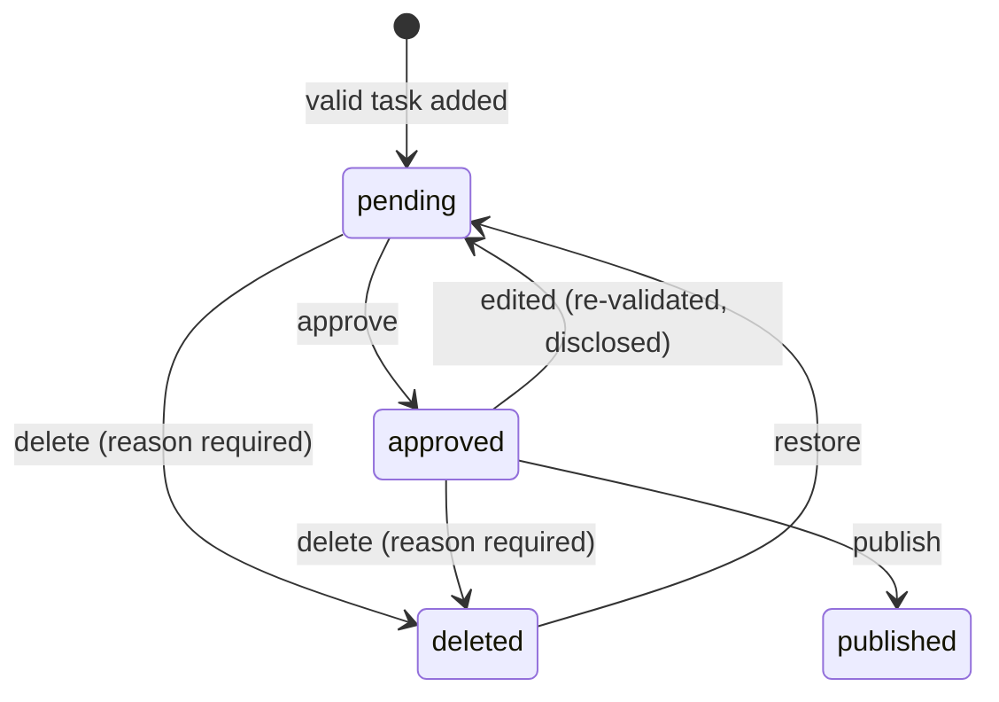

# Concepts

## Task

- A coding exercise on a real repository at one pinned commit.
- Has three parts:
  - **Requirements** — what to build or fix; the only part the solver sees.
  - **Reference solution** — a diff that solves it; hidden.
  - **Hidden tests** — decide whether a solution is correct; hidden.
- A task is **valid** when its tests prove the requirements: they fail without a solution, pass with the reference, and catch wrong solutions.

## Task package

- One folder per task; the same layout for every way a task is made.

```
<task_id>/
├── instruction.md          Requirements (visible to the solver)
├── task.toml               Metadata (see below)
├── solution/solution.diff  Reference solution (hidden)
├── tests/files/…           Hidden test files, at their repository paths
├── tests/run_tests.sh      Runs the hidden tests against a working copy
├── environment/
│   ├── Dockerfile          Rebuilds the sandbox image
│   ├── env.json            Setup and test commands, protected paths
│   └── repo.tar            The repository at the pinned commit
├── validation/             Evidence: gate logs, or SWE test runs
├── swe.json                SWE tasks only: SWE-bench record and quality flags
└── checksums.txt           SHA-256 of every task file
```

- `task.toml` fields:

| Field | Meaning |
|---|---|
| `task_id` | `<repo>-<short sha>-<slug>-<n>` (gated) or `<repo>-<short sha>-<slug>-pr<n>` (SWE) |
| `repo`, `repo_name`, `commit_sha` | The repository and the starting commit (full SHA) |
| `language`, `test_command` | How the tests run |
| `kind` | `feature`, `bugfix` or `behavior_change` |
| `tags`, `idea_id` | Labels used for variety and grouping |
| `touched_files` | Files the reference solution changes |
| `test_files` | The hidden test files |
| `fail_to_pass` | Test IDs that fail without a solution and pass with it |
| `pass_to_pass` | Test IDs that pass before and must keep passing |
| `known_failures` | Tests that already fail at the commit (ignored) |
| `environment` | The full environment (image, setup, test command, protected paths) |
| `generated_by` | Who made the task: `human`, a model, or `swe-miner` |
| `validation` | Verdict, gates run, mutation score |
| `manual_edit`, `manual_edit_reason` | Set when a person edited the task |

## Two ways to make tasks

| | Gated pipeline | SWE miner |
|---|---|---|
| Source | A person or a model writes the task | A merged pull request that closes an issue |
| Proof of validity | Seven gates, G0–G6 | One run before the fix, two after, one full suite |
| Problem statement | `requirements.md` | The issue text |
| Languages | Any (configured) | Python |
| Guide | [Gated pipeline](gated-pipeline.md) | [SWE miner](swe-miner.md) |

## Review states



- Only **approved** tasks are published.
- Deleted tasks move to `tasks/.trash/` and can be restored.
- Every decision is appended to `tasks/.review/log.jsonl` with who, when and why.

## Attempt verdicts

| Verdict | Meaning |
|---|---|
| `resolved` | Every hidden test passes and no existing test broke |
| `wrong_behaviour` | Some hidden tests fail |
| `regression` | Hidden tests pass, but an existing test broke |
| `build_error` | The tests could not run |
| `no_change` | The agent changed nothing |
| `patch_apply_fail` | The agent's change could not be applied for grading |
| `timeout` | The agent ran out of time |
| `agent_error` | The agent failed (bad model, missing key, quota) — not counted as a failure of the model |
| `leak` | Hidden files were found in the agent's sandbox (never expected) |

## Glossary

| Term | Meaning |
|---|---|
| **Gate** | One automatic validity check (G0–G6) |
| **Mutant** | A deliberately wrong version of the reference solution; good tests catch it |
| **FAIL_TO_PASS** | Hidden tests that fail before a solution and pass after it |
| **PASS_TO_PASS** | Tests that passed before and must not break |
| **Oracle** | An agent that applies the reference solution; must resolve every task |
| **Noop** | An agent that changes nothing; must resolve no task |
| **Store** | A folder of packages with its review log |
| **SWE store** | The store for one mined GitHub repository |
| **Work folder** | Where a project's state lives (`workdir/`, or `~/.local/state/task-factory/projects/…` for the terminal) |
| **Egress allowlist** | The only hosts an agent's sandbox may reach (the model APIs) |
| **Dual write** | Records are written to files and, when configured, to MongoDB |
| **resolved@k** | Share of tasks solved in at least one of k attempts |
