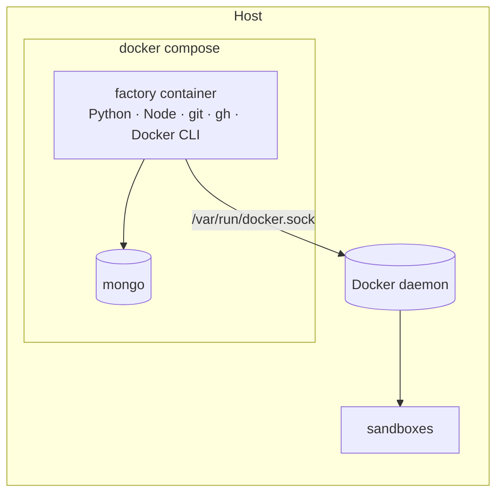

# Deployment

MongoDB records, running everything in containers, and managing disk space.

## MongoDB records

- Task packages stay files (their layout is the deliverable).
- Every **record** is also written to MongoDB when `TASK_FACTORY_MONGO_URI` is set (dual write).
- Files stay what the pipeline reads: it works the same without MongoDB.
- A failed write warns once and switches MongoDB off for that process; `factory db sync` fills the gap later.
- Every record has a fixed `_id`: a live write and a sync never create duplicates.

```sh
docker compose up -d mongo
export TASK_FACTORY_MONGO_URI=mongodb://127.0.0.1:27017/task_factory
factory db sync                  # every work folder and SWE store on this machine
factory db sync --path DIR       # one folder
factory db status                # documents per collection
```

| Collection | Contents |
|---|---|
| `tasks` | Index of every package with its review status |
| `review_events` | Approvals, deletions, edits, assignments |
| `generations` | `/generate-task` history |
| `attempts`, `runs` | Harness results |
| `rejections` | Tasks that failed a gate |
| `session_runs`, `session_tasks` | Terminal session links |
| `swe_prs`, `swe_mining` | SWE miner outcomes and funnel |

- The TypeScript side writes through `python -m factory.records sync <folder>`; it needs no MongoDB driver.

## Containers



- `docker-compose.yml` defines two services:
  - `mongo` — MongoDB 8 on `127.0.0.1:27017`, data in the `mongo-data` volume;
  - `factory` — the pipeline image built from `Dockerfile` (profile `cli`).
- Sandboxes are siblings on the host's Docker (through its socket), not nested.
- Images, the engine volume and the egress proxy are shared with runs started on the host.

```sh
docker compose up -d mongo
scripts/factory-docker factory tasks list --workdir ~/.local/state/task-factory/swe/pallets-click
scripts/factory-docker swe mine https://github.com/pallets/click --max 5
scripts/factory-docker sh                 # a shell inside the container
```

- `scripts/factory-docker`:
  - runs as your user and group (files in mounted folders stay yours);
  - adds the Docker socket's group;
  - passes `gh auth token` as `GH_TOKEN`;
  - mounts the state folder, the engine (read-only), the host's timezone and the current folder as `/work`.
- Set `TF_WORK=/path` to mount another folder as `/work`.
- Provider keys (`NVIDIA_API_KEY`, `OPENROUTER_API_KEY`, …) are passed through when set.
- Windows: use WSL (the wrapper is a POSIX shell script).
- The terminal UI runs on the host, not in the container.

## Disk usage

| Item | Size | Shared? |
|---|---|---|
| Task image (one per repository commit) | ~350–450 MB | Base layers shared |
| Engine volume (`factory-file-<digest>-task-factory-engine`) | ~233 MB | Once for all tasks |
| Agent image (only for agents that install something) | Varies | Per task image |
| SWE store clone | Size of the repository | Per repository |

```sh
factory images prune --dry-run     # what would go
factory images prune               # agent images and unused engine volumes (rebuilt on demand)
factory images prune --all         # also every task image (rebuilt from packages when needed)
docker builder prune               # the build cache
```

## Ports and conflicts

- MongoDB uses `127.0.0.1:27017`; stop any other MongoDB on that port, or change the mapping in `docker-compose.yml`.
- The egress proxy has no published port; it is reachable only from `factory-egress`.
