# task-factory: design

This document explains how task-factory is built and why. It is written for
someone who has never seen the project: a judge, a new contributor, or an
engineer who wants to run it on their own repository. For a short overview
start with the [README](../README.md); for every individual assumption and
deviation see [decisions.md](decisions.md).

**Contents**

1. [Goals and non-goals](#1-goals-and-non-goals)
2. [The big picture](#2-the-big-picture)
3. [Module map](#3-module-map)
4. [Data flow through the work folder](#4-data-flow-through-the-work-folder)
5. [Core data models](#5-core-data-models)
6. [Sandbox: isolated, repeatable execution](#6-sandbox-isolated-repeatable-execution)
7. [Repo loader and inspector](#7-repo-loader-and-inspector)
8. [Test runner and report parsers](#8-test-runner-and-report-parsers)
9. [Validation runner: the gates](#9-validation-runner-the-gates)
10. [Mutation engine: negative controls](#10-mutation-engine-negative-controls)
11. [Task packages](#11-task-packages)
12. [Human review and authoring](#12-human-review-and-authoring)
13. [Coding harness](#13-coding-harness)
14. [Harbor compatibility](#14-harbor-compatibility)
15. [Life of a task](#15-life-of-a-task)
16. [Reproducibility guarantees](#16-reproducibility-guarantees)
17. [How it is tested](#17-how-it-is-tested)
18. [Extending task-factory](#18-extending-task-factory)
19. [Roadmap](#19-roadmap)
20. [Glossary](#20-glossary)

---

## 1. Goals and non-goals

**The deliverable is the factory, not any single task.** It must work on a
repository it has never seen, with no code changes, and every task it exports
must come with evidence that it is valid.

| Goal | How the design meets it |
| --- | --- |
| Works on any supplied repo | Language, setup and test command are detected, never hard-coded; anything unknown stops with `needs_manual_config` and the reasons |
| Validity is proven, not claimed | Seven gates run real tests in containers; an LLM never decides pass or fail |
| Repeatable | Pinned commit, image tag derived from inputs, fixed environment variables, deterministic task IDs and checksums |
| Auditable | Every gate keeps its command, exit code, output and parsed results as a log file inside the package |
| Isolated and safe | A fresh container per gate, no network, memory/CPU/process limits, non-root user |
| Human judgement | Every valid task waits for a reviewer; only approved tasks are published; deletions need a reason |
| Measurable | A coding harness runs real agents on the tasks; the oracle must score 100% and an empty agent 0% |
| Honest | Manual edits and human deletions are disclosed; limitations are written down in `decisions.md` |

**Not in scope:** training models, a web UI, a leaderboard, tasks that need network
access or external services, and (until the organizers confirm) security or
exploit-style tasks.

## 2. The big picture

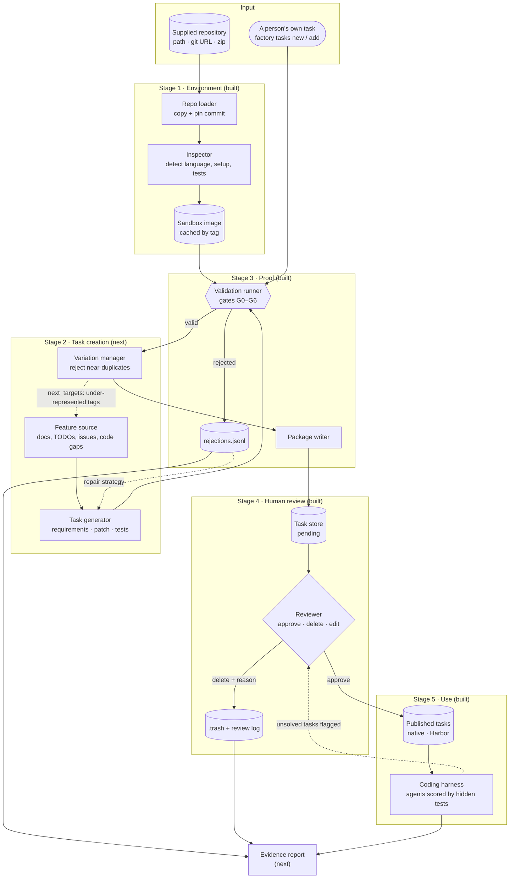

Three ideas shape the whole system:

1. **Only executed tests decide validity.** Models may write requirements,
   patches and tests, but the verdict comes from the validation runner, which
   only runs code.
2. **Every step is a pure function of files.** Each command reads JSON from the
   work folder and writes JSON back. Steps can be rerun, resumed and inspected.
3. **Machines prove validity, people decide quality.** Gates make a broken task
   impossible to export; a reviewer makes a dull or unclear one impossible to
   publish. Every human decision is logged and disclosed.
4. **Anything the organizers have not fixed yet sits behind one adapter.** The
   package layout, the repo delivery format and the LLM provider can each be
   swapped by changing a single module.

## 3. Module map

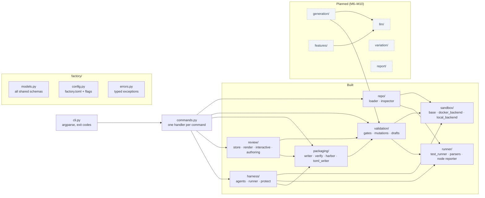

Rules the code follows:

- `cli.py` holds no business logic. Each command calls exactly one component.
- Components never pass raw dicts to each other; they pass the pydantic models from `models.py`.
- No provider-specific LLM code outside `llm/`.
- Errors are typed (`BuildError`, `SandboxStartError`, `RepoLoadError`, `PackageError`, …).
  The CLI maps them to exit codes. There is no bare `except` and no silent retry.

## 4. Data flow through the work folder

Every command reads and writes plain files under `workdir/`, which is why a run
can be stopped at any point and resumed.

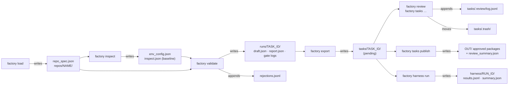

```text
workdir/
├── repo_spec.json          pinned repo (RepoSpec)
├── inspect.json            inspector result + baseline test run
├── env_config.json         how to build and test (EnvConfig)
├── repos/<name>/           our copy of the repo (the original is never edited)
├── cache/baseline/         baseline results, one file per image tag
├── runs/<task_id>/         draft.json, report.json, one log file per gate run
├── rejections.jsonl        one line per rejected task: code, reason, log paths
├── tasks/                  the task store: one package per valid task
│   ├── .review/log.jsonl   every approve / delete / restore / edit, with who, when and why
│   └── .trash/             deleted packages (restorable)
├── drafts/<name>/          tasks people are writing (factory tasks new)
├── edits/<task_id>/        editable copies of packages (factory tasks edit)
├── harness/<run_id>/       agent runs: per attempt agent.diff, solution.diff, agent log, grade.json
├── solutions/<repo>/       clone holding one branch per passing AI solution (ai/<agent>-<model>/<task>)
└── logs/run-*.jsonl        structured log of every command, LLM and container call
```

A finished step is skipped on the next run unless `--force` is given.

## 5. Core data models

All models live in `factory/models.py`, carry `schema_version`, reject unknown
fields and serialize to JSON.

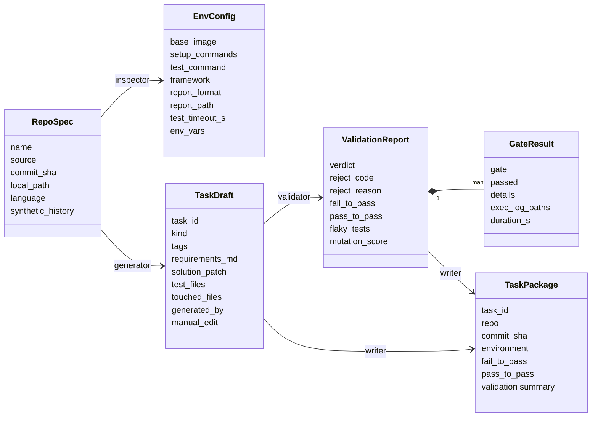

Two rules give stable identities:

- **Task ID** = `<repo>-<short_sha>-<slug>-<nnn>`, for example
  `toyshop-a471ba4-bulk-discount-on-cart-lines-007`. Same repo, commit, title
  and number always give the same ID.
- **Reject codes** are a fixed enum: `BASELINE_FAIL`, `PATCH_APPLY_FAIL`,
  `FEATURE_TESTS_FAIL_WITH_PATCH`, `FEATURE_TESTS_PASS_WITHOUT_PATCH`,
  `REGRESSION`, `FLAKY`, `NEG_CONTROL_PASSED`, `SOLUTION_TOUCHES_PROTECTED`.

## 6. Sandbox: isolated, repeatable execution

Every gate, and later every solver run, executes inside a sandbox. The
interface is small:

```python
class Sandbox:
    def exec(argv, *, timeout_s, env=None, cwd=None) -> ExecResult   # never raises on non-zero exit
    def write_file(path, content) -> None
    def read_file(path) -> bytes
    def apply_patch(diff) -> ExecResult                             # git apply --check, then git apply
    def close() -> None                                             # also runs on exceptions

class SandboxFactory:
    def build_image(spec, env) -> ImageRef
    def new_sandbox(image, *, network=False) -> Sandbox             # context manager
```

### How an image is built

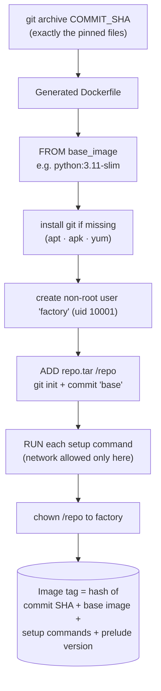

Because the tag is a hash of its inputs, an existing image is reused and
nothing is rebuilt. Change any input and you get a new tag.

### Isolation rules

| Rule | Value |
| --- | --- |
| Container per sandbox | always new, never reused between gates; removed on `close()`, even after an exception |
| Network | `--network none` (only the image build may download dependencies) |
| Limits | 2 GB memory, 2 CPUs, 512 processes (configurable) |
| User | commands run as the non-root `factory` user when the image allows it |
| Fixed environment | `TZ=UTC`, `LANG=C.UTF-8`, `PYTHONHASHSEED=0`, `CI=1` |
| Timeout | hard; on timeout every process except PID 1 is killed and `timed_out=true` |
| Output | stdout and stderr cut at 1 MB each, with a visible truncation marker |

### One command with a timeout

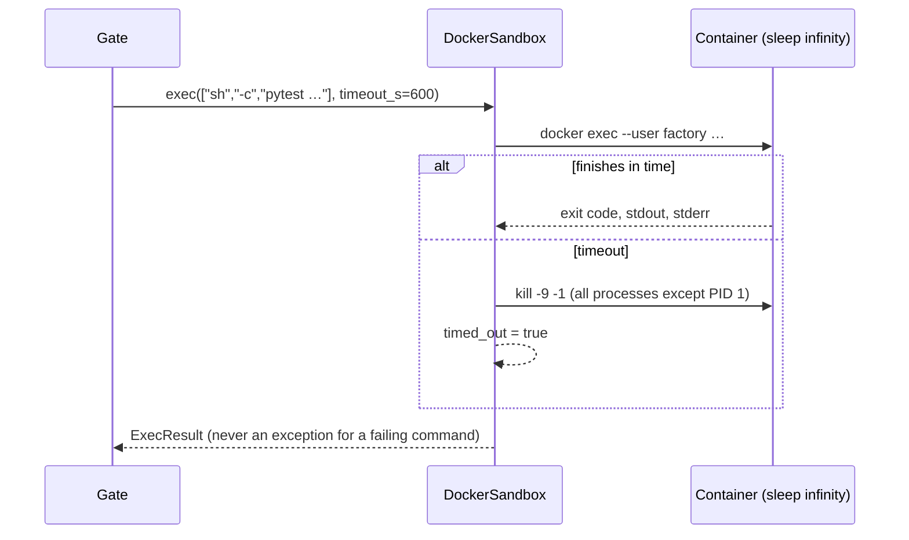

A second backend, `LocalSandbox`, runs in a temporary folder on the host. It
exists only to make unit tests fast, has **no isolation**, and logs a warning on
every use.

## 7. Repo loader and inspector

**Loader.** Accepts a local path, a git URL or a zip. It copies the repo to
`workdir/repos/<name>`, checks out the requested commit (default `HEAD`) and
records the full 40-character SHA. It refuses a working tree with uncommitted
changes. A zip or folder without git history gets a *synthetic* commit with a
fixed author and date, so the same zip always gives the same SHA.

**Inspector.** Detects the environment from marker files and never guesses
silently:

| Marker | Base image | Setup | Test command |
| --- | --- | --- | --- |
| `pyproject.toml`, `setup.py`, `requirements*.txt` | `python:3.11-slim` (raised by `requires-python`) | `pip install -e '.[test]'`, requirement files, pytest | pytest with a JUnit report |
| `package.json` + `package-lock.json` | `node:22-slim` | `npm ci` (yarn, pnpm supported) | Jest, Vitest or node:test |
| `pom.xml` / `build.gradle` | Maven / Gradle JDK 17 | dependencies go offline at build time | `mvn -o test` / `gradle --offline test` |
| `go.mod` | `golang:1.22` | `go mod download` | `go test -json` |
| `Cargo.toml` | `rust:1-slim` | `cargo fetch`, build tests | `cargo test --offline` |

Anything else, or an unknown Node test runner, returns `needs_manual_config`
with the reasons. Every field can be overridden in `factory.toml` under `[env]`.
The **smoke check** then builds the image and runs the full suite once; a crash
at this point is reported, not ignored.

## 8. Test runner and report parsers

The test command is a template with two placeholders:

```text
python -m pytest -q -o junit_family=xunit1 --junitxml={report} {select}
```

- `{report}` becomes the report path inside the repo (`.factory/report.xml`).
- `{select}` becomes the chosen tests or test files; empty means the full suite.

The runner prefers machine-readable reports over scraping text:

| Format | Frameworks | Example test ID |
| --- | --- | --- |
| JUnit XML | pytest, node:test, Maven Surefire, Gradle, Vitest | `tests/test_cart.py::test_add_and_quantity` |
| Jest JSON | Jest | `src/sum.test.js::sum adds` |
| `go test -json` | Go | `example.com/m/calc::TestAdd` |
| libtest text | Cargo | `calc::tests::adds` |

Two rules prevent false confidence:

- **A crash is never "all passed".** A non-zero exit with no parsed tests (a build
  or import error) is reported as an error with the last lines of output.
- **Flaky tests are named.** `run_repeated` runs the same selection several
  times; any test whose status changes between runs is flaky.

Node's built-in JUnit reporter omits the test file before Node 23, which made
IDs ambiguous. The runner therefore writes a small reporter
(`runner/node_junit_reporter.mjs`) into the sandbox and uses it for node:test
projects.

## 9. Validation runner: the gates

The validation runner turns a `TaskDraft` into a `ValidationReport`. Every gate
starts a fresh sandbox from the same image, saves its log, and the first
failure stops the run with its reject code.

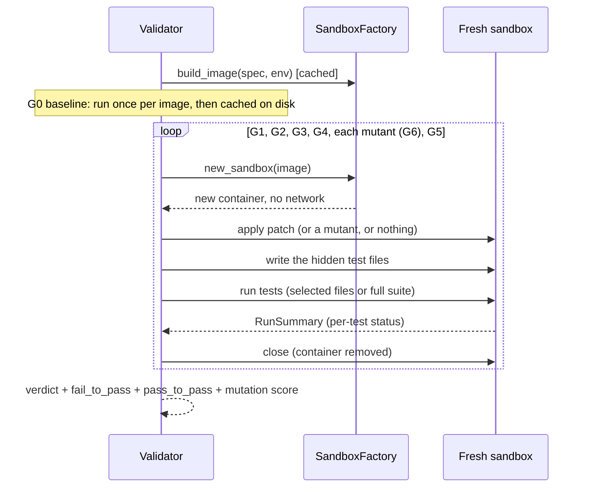

### What each gate checks, exactly

| Gate | Patch applied | Tests run | Passes when | Reject code |
| --- | --- | --- | --- | --- |
| **G0** Baseline | none | full existing suite | it runs, something passes, and failing tests ≤ 20% (they become `known_failures` and are ignored later) | `BASELINE_FAIL` |
| **G1** Patch applies | reference | none | the patch is not empty, changes no protected file (tests or test/build config, see §13), and `git apply --check` succeeds | `PATCH_APPLY_FAIL`, `SOLUTION_TOUCHES_PROTECTED` |
| **G2** Feature passes | reference | the task's test files | every *new* test ID passes; at least one exists | `FEATURE_TESTS_FAIL_WITH_PATCH` |
| **G3** Feature fails without patch | none | the task's test files | every new test fails; tests that pass are named in the reason | `FEATURE_TESTS_PASS_WITHOUT_PATCH` |
| **G4** Regression | reference | full suite + new tests | every test that passed at baseline still passes, and the new tests pass inside the full suite too | `REGRESSION` |
| **G6** Negative control | each mutant | the task's test files | every mutant makes at least one new test fail | `NEG_CONTROL_PASSED` |
| **G5** Stability | reference | G2's selection and G4's full suite, repeated N times | every test has the same status in every run | `FLAKY` |

Details that matter:

- **Feature tests are the new test IDs**, meaning IDs present in the task's
  test files but not in the baseline. A task may therefore extend an existing
  test file; the old tests in it count as existing tests.
- **In G3, a missing test counts as failing** only if the run exited non-zero
  (for example an `ImportError` because the function does not exist yet).
- **G5 runs last** because it is the most expensive, and only for tasks that
  already passed everything else. Its repeats happen inside one fresh sandbox,
  so tests that depend on state left by an earlier run are caught too.
- **Running the same task twice gives the same verdict, codes and test lists.**
  A test checks this.
- **The reference solution may not change protected files.** The grader undoes
  every solver change to tests and test/build config (§13). A reference patch
  that edits `tests/conftest.py` would therefore be impossible for any solver to
  match; such test changes belong in the hidden test files, which are written
  after the restore.
- **The baseline cache key includes the test settings** (test command, timeout,
  report format), not only the image, so changing the test command reruns G0.
- **G6 says when no code mutant could be made** (for example a patch that only
  adds a data structure). The task then passes on G3 alone, and the report says
  so instead of showing a misleading "1/1 caught".

### What kinds of tasks fit

A task fits when its behaviour can be checked by an automated test that fails
before the change and passes after it. Checked on toyshop with one hand-written
task per area (all seven gates, 10 stability repeats, all six mutation operators;
an AI model solved the security task):

| Area | Fits | Example that passed every gate | Does not fit |
| --- | --- | --- | --- |
| Security | flaws a test can demonstrate: injection, input validation, path traversal, authorization checks, secrets kept out of logs | receipt line injection through product names + SKU allowlist | anything needing a network or live service (sandboxes are offline); a test proves one attack is blocked, not that the code is secure |
| Scalability | algorithmic cost inside one process | a tag index so `by_tag` costs the same on 100k products as on 1k; measured as a **ratio** of timings, not absolute time, so it holds on any machine | distributed scale (load balancers, sharding, many machines): one container, 2 CPUs |
| Design | code and API design that shows in behaviour: new extension points, interfaces, error rules | pluggable coupon rules (`register_coupon`) | a pure refactor (behaviour unchanged, so G3 must fail); architecture documents and visual UI design (need a rubric or judge, not built) |

Two rules shape such tasks. Every hidden test must fail without the change
(G3), so "guard" assertions that already pass go inside a failing test, not in a
test of their own. Timing-based tests need correctness assertions too, because
the mutation operators rarely find anything to mutate in a pure performance
change.

### Cost per task

| Work | Sandboxes |
| --- | --- |
| G0 baseline | 1 per image, then cached |
| G1, G2, G3, G4 | 4 |
| G6 | 1 per mutant (the empty-patch control reuses G3) |
| G5 | 1 (with N repeats inside) |

With the development defaults (2 mutants, 1 repeat) that is about 7 containers
per task; the toy tasks validate in a few seconds each.

## 10. Mutation engine: negative controls

G3 shows that the tests fail when the feature is **absent**. It does not show
that they fail when the feature is **wrong**. G6 closes that gap: it takes the
reference patch, breaks it in small plausible ways, and checks that the hidden
tests notice.

Mutants change only lines the patch **adds**, so a mutant applies wherever the
reference applies.

| Operator | Before (reference line) | After (mutant) |
| --- | --- | --- |
| `empty` | the whole patch | no patch (reuses G3) |
| `flip_comparison` | `if qty >= BULK_MIN_QTY:` | `if qty > BULK_MIN_QTY:` |
| `drop_error_branch` | `raise ValueError("bad wpm")` / `throw new RangeError(…)` | `pass` / `;` |
| `swap_arguments` | `x = g(a, b)` | `x = g(b, a)` |
| `hardcode_expected` | `return amount` | `return 900` (a value the tests expect) |
| `revert_half` | two hunks | only the first hunk (a partial implementation) |

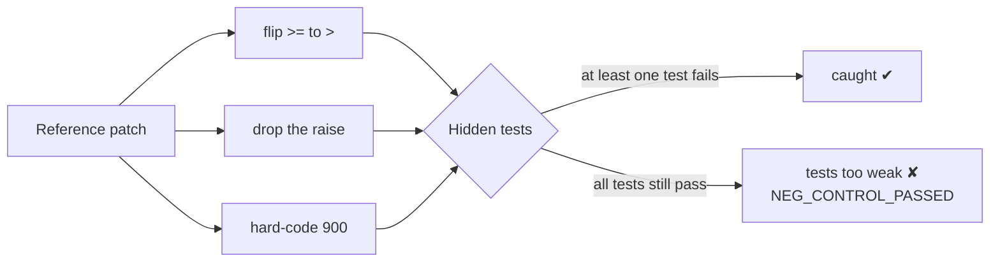

**Safety rules.** Operators skip comment lines, function and import lines, and
operators inside string literals, because a mutant that cannot change behaviour
would reject a good task unfairly. Mutants identical to the reference or to
each other are dropped. The report records how many mutants ran and how many
were caught (`mutation_score`).

**Known limit.** Mutation testing is heuristic. An *equivalent* mutant (one that
cannot change behaviour, such as swapping the arguments of a symmetric function)
survives and rejects a good task. The operator set is configurable
(`gates.mutations`), and every survivor is named in the reject reason so a person
or the repair loop can see why.

## 11. Task packages

```text
toyshop-a471ba4-bulk-discount-on-cart-lines-007/
├── instruction.md            requirements: the ONLY file the solver sees
├── task.toml                 metadata (below)
├── solution/solution.diff    reference patch (hidden)
├── tests/
│   ├── files/tests/test_bulk_discount.py   hidden feature tests at their repo paths
│   └── run_tests.sh          copies the tests into a working copy and runs them
├── environment/
│   ├── Dockerfile            rebuilds the exact sandbox image (docker build environment/)
│   ├── env.json              EnvConfig
│   └── repo.tar              the pinned commit (git archive): the package is self-contained
├── validation/
│   ├── report.json           every gate with its details
│   └── logs/G0.json …        raw command, exit code, output, parsed results
└── checksums.txt             SHA-256 of every task file
```

An excerpt of a real `task.toml`:

```toml
task_id = "toyshop-a471ba4-bulk-discount-on-cart-lines-007"
repo_name = "toyshop"
commit_sha = "a471ba47d0913375f9bcbb3b7557bca97f39c881"
language = "python"
kind = "feature"
tags = ["validation rule", "data transformation"]
touched_files = ["toyshop/pricing.py"]
fail_to_pass = ["tests/test_bulk_discount.py::test_bulk_discount_boundary", "…in_subtotal", "…rounds_half_up"]
pass_to_pass = ["tests/test_cart.py::test_add_and_quantity", "…"]   # 28 tests
manual_edit = false

[environment]
base_image = "python:3.11-slim@sha256:07d4824036af…"   # pinned by digest at inspect time
framework = "pytest"

[validation]
verdict = "valid"
gates = ["G0", "G1", "G2", "G3", "G4", "G6", "G5"]
mutation_score = 1.0
```

### Writing and re-verifying

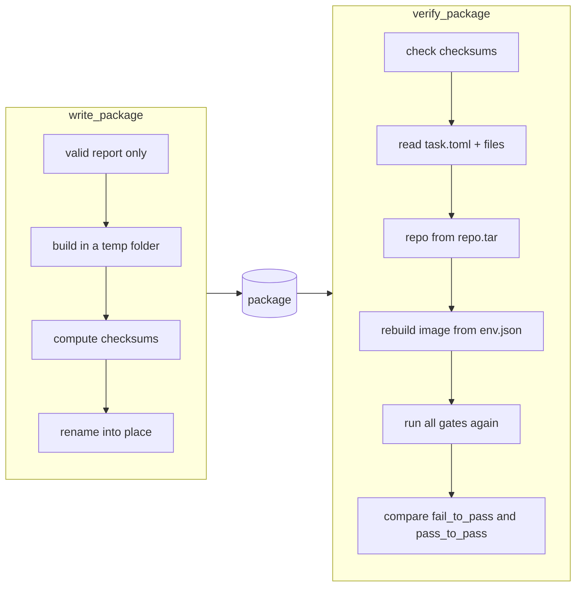

- Only tasks with verdict `valid` are written. A rejected task writes nothing.
- Writes are atomic: the package is built in a temporary folder and renamed, so
  a crash never leaves half a package.
- `checksums.txt` covers the task files (instruction, `task.toml`, solution,
  tests, environment). It leaves out `validation/`, because logs contain
  timings that differ on every run and would break "same seed, same checksums".
- **A package is self-contained.** `environment/repo.tar` holds the pinned
  commit, so `docker build environment/` works on any machine, and re-verifying,
  editing, Harbor export and the harness all read the repo from it. The original
  repo does not have to exist any more (older packages without `repo.tar` fall
  back to it). For toyshop the archive is 30 KB.
- The package layout lives in `packaging/writer.py` only. When the organizers
  publish their template, that one module changes.

## 12. Human review and authoring

Gates can prove that a task is valid. They cannot tell whether it is worth
having: whether the requirements read clearly, whether the change is
realistic, whether it is too easy or a near-copy of another task. That needs a
person, so review is a first-class step, not an afterthought.

### The task store

Every valid package goes into a **task store** folder (default `workdir/tasks/`).
The store keeps the packages, a trash folder, and an append-only review log:

```text
tasks/
├── toyshop-a471ba4-bulk-discount-on-cart-lines-007/   a package (section 11)
├── .trash/<task_id>/                                  soft-deleted packages
└── .review/log.jsonl                                  {"ts", "task_id", "action", "reviewer", "reason"}
```

The **log is the source of truth** for status. Nothing about review is written
into the package itself, so reviewing never changes a package's checksums.

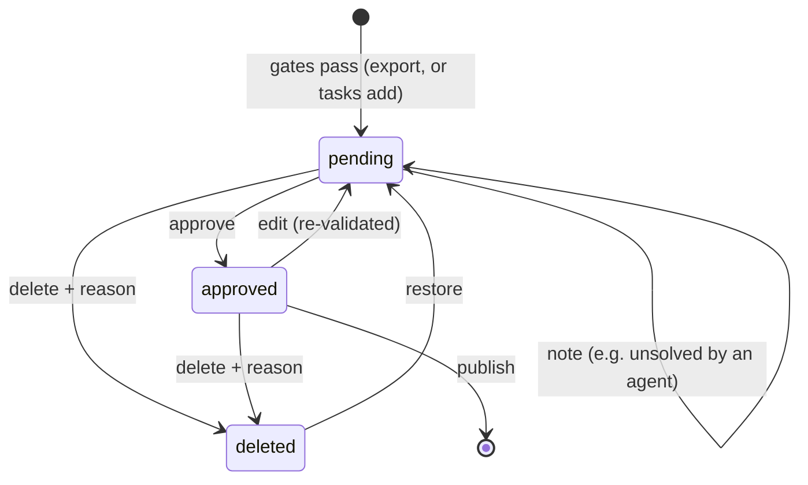

| Action | Effect | Recorded |
| --- | --- | --- |
| approve | status `approved`; only approved tasks are published | reviewer, optional note |
| delete | package moves to `.trash/`; status `deleted` | reviewer, **required** reason |
| restore | package moves back; status `pending` | reviewer |
| edit | package replaced after re-validation; `manual_edit = true`; status `pending` | reviewer, **required** reason |
| note | no status change | free text (the harness adds "unsolved by …") |

The reviewer's name comes from `git config user.name` (or the login name) and
never leaves the machine.

### Reviewing

`factory review` walks through pending tasks one at a time. For each it shows a
summary panel (status, repo and commit, tags, touched files, test counts,
mutation score, a coloured pass bar for every gate, the last review events) and
the instruction exactly as the solver will see it. Single keys open the
reference diff with syntax colours, the hidden tests, the gate table with log
paths, or start an edit. The same views are available non-interactively with
`factory tasks show TASK_ID --section …`, so review also works in scripts and CI.

### Writing your own task

`factory tasks new NAME` scaffolds a draft folder with a `HOW_TO.md` that lists
what each gate will demand. The author fills in `requirements.md`, the changed
source files under `after/` (or a `solution.diff`), and the hidden tests under
`tests/`. `factory tasks add DIR` then runs **all seven gates**; there is no
shortcut for humans. A task that passes is written to the store, marked
`generated_by.model = "human"` with the author's name, and approved (or left
pending with `--pending`). A task that fails writes nothing and prints the gate
that rejected it.

### Editing a task

`factory tasks edit TASK_ID` unpacks a package into an editable draft
(`requirements.md`, `solution.diff`, `tests/`). `--apply --reason "…"` re-runs
the gates on the edited draft. If it is still valid, the package is replaced,
`manual_edit` and `manual_edit_reason` are set in `task.toml`, and the task goes
back to `pending` so someone looks at it again. If not, the old package stays
untouched.

### Publishing

`factory tasks publish --out DIR [--format native|harbor]` copies only approved
tasks and writes `review_summary.json` beside them: counts per status, every
deletion with its reason and reviewer, every human-authored task, and every
manual edit with its reason. That file is the disclosure the organizers ask for.

Publishing again into the same folder removes task folders that are no longer
approved (deleted or unapproved since the last publish), so a submission folder
never keeps a task a reviewer threw out. It only removes tasks the store knows:
a folder from another store or another machine, or a publish from an empty or
wrong `--store`, never deletes anything (it lists those folders as kept). In the other direction, `factory
export` never overwrites a package that is already in the store (a reviewer may
have approved or edited it); `--force` does.

## 13. Coding harness

The harness runs an AI coding agent on task packages and scores it with the
hidden tests. It is how we show that tasks are solvable but not trivial, and
it gives reviewers real evidence (a task nobody solves may be unfair).

### One attempt

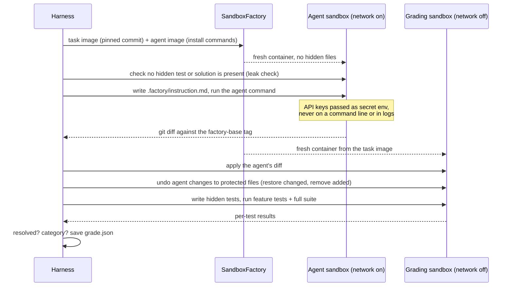

Design choices:

- **Two sandboxes per attempt.** The agent needs network for its model API, so it
  runs in its own container. Grading happens in a second, fresh, offline
  container, so nothing the agent left running can interfere.
- **The agent never sees hidden files.** The agent image is built from the
  pinned commit only; a leak check confirms the hidden test files and the
  solution are absent before the agent starts.
- **`factory-base` tag.** Every image tags its starting commit, so the diff is
  correct even if the agent makes its own commits.
- **Grading cannot be faked.** Before grading, every agent change to a
  *protected* file is undone: changed or deleted ones are restored, added ones
  are removed. Protected means test files (`tests/`, `test_*.py`, `*_test.go`,
  `*.test.js`, `src/test/`, …) and files that control how tests are collected or
  run: `conftest.py`, `pytest.ini`, `tox.ini`, `setup.cfg`, `pyproject.toml`,
  `package.json`, jest/vitest/mocha config, `sitecustomize.py`, `*.pth`, `go.mod`,
  `Cargo.toml`, `pom.xml`, Gradle files. The attempt lists them in
  `tests_tampered`. Without this, a six-line `conftest.py` that reports every
  test as passed "resolved" a task with no implementation at all (found in
  review and now covered by tests, including a real Harbor container).
  Restoring build files is safe because dependencies are installed when the
  image is built, never during grading.
- **Real agents run only in Docker.** The local backend has no isolation, so the
  harness refuses to run agent presets there; `oracle`, `noop` and `command`
  are allowed for tests.

### Assignments and the worker

A reviewer (or a script) assigns tasks to a test model; a worker runs them.

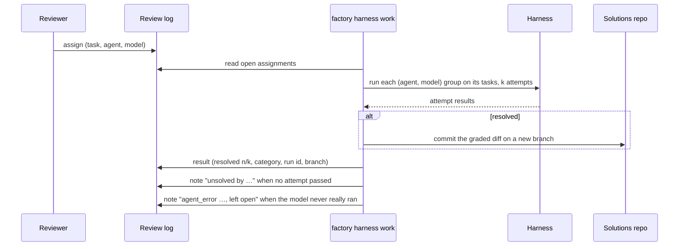

An assignment is an `assign` event in the review log with the agent and model.
It stays open until a `result` (written by the worker) or an `unassign`.
Assigning never changes a task's review status, and a deleted task cannot be
assigned.

Not every failure is a result. When every attempt ended in `agent_error` (an
exhausted free quota, a wrong model ID, a missing key) or `leak`, the worker
leaves the assignment **open** and adds a note instead of an "unsolved" verdict,
so the next `factory harness work` retries it. A run also **stops early** after
two agent errors in a row, because a quota or ID problem fails every remaining
task the same way; the tasks it did not reach stay open. `factory tasks assignments --all` shows every assignment with its
result and branch.

### Passing solutions become git nodes

For every resolved attempt the worker records the solution as a new commit in a
**solutions repo** (`workdir/solutions/<repo>`, a clone; the supplied repo is
never touched):

1. check out the task's base commit (detached);
2. apply exactly the diff that was graded: the agent's diff with any restored
   test files removed, so the branch holds the source change only, and never
   the hidden tests;
3. commit as `task-factory harness`, with the task, base commit, agent, model,
   attempt, hidden-test counts and run id in the message;
4. create the branch `ai/<agent>-<model>/<task_id>` (a `-2`, `-3`, … suffix when
   it already exists).

```text
* <sha>    (ai/<agent>-<model>/toyshop-…-007)  Bulk discount on cart lines: solved by <agent>
|
* <base>   base commit of the task
```

The branch can be inspected with `git diff <base> <branch>`, compared with the
reference solution, or pushed for review like any pull request. Branches are
made for real agents only (not for `oracle` or `noop`); `--no-branch` or
`harness.branches = false` turns them off.

### Model providers

The default agent is `task-factory`: the Task Factory engine binary, copied
into the agent image with a `COPY` (the image tag includes the binary's
SHA-256, so a rebuilt engine gets a new image). It reaches many providers,
selected by the model's prefix: `opencode/…` (Zen, including free models), `nvidia/…`
(build.nvidia.com), `tokenrouter/…`, and `amazon-bedrock/…` (for example
`amazon-bedrock/qwen.qwen3-coder-480b-a35b-v1:0`). mini-swe-agent reaches the same
providers through LiteLLM (`bedrock/…`, `nvidia_nim/…`, `openrouter/…`).

Credentials reach the sandbox in one of two ways, both without touching a
command line or a log:

- **Environment variables** listed in the agent's `secrets`
  (`NVIDIA_API_KEY`, `TOKENROUTER_API_KEY`, `TASK_FACTORY_API_KEY`, the `AWS_*` set, …),
  passed as `docker exec -e NAME` with the value in the docker CLI's environment.
- **`--use-host-auth`** (opt-in, for agents that declare a login file): the
  harness reads the agent's own login file on the host, keeps **only the entry for the model's
  provider**, and writes it into the sandbox through stdin with mode 600. The
  container is deleted after the attempt.

The bundled engine was verified end to end on 2026-11-23: `factory harness work`
with `opencode/deepseek-v4.1-flash-free` resolved the toy task in 44 seconds
inside a `python:3.11-slim` task image and produced a branch. The engine's own
logins (made in the terminal with `/connect`, stored in
`~/.local/share/task-factory/auth.json`) are what `--use-host-auth` copies. Two
catalogue model IDs on other providers were rejected by the provider ("model
not found"); such runs are graded `agent_error` so a setup problem is never
mistaken for a weak model.

### Agents are data

An agent is a small record: install commands (run as root when the agent image
is built and cached), a run command template, a model flag, and the names of
the environment variables it may receive.

```toml
[harness.agents.my-agent]
install = ["pip install -q my-agent"]
run = "my-agent --task-file {instruction_file} {model_args}"
model_flag = "--model {model}"
secrets = ["MY_API_KEY"]
```

Built in: `oracle` (applies the reference patch), `noop` (does nothing),
`command` (any shell command), and presets for Claude Code, Codex CLI, Aider and
mini-swe-agent.

### Scores

| Category | Meaning |
| --- | --- |
| `resolved` | every fail_to_pass and every pass_to_pass test passes |
| `wrong_behaviour` | some fail_to_pass test fails |
| `regression` | the feature works but an existing test broke |
| `build_error` | the tests could not even run |
| `no_change` | the agent produced no diff |
| `timeout` | the agent ran out of time |
| `patch_apply_fail` | the agent's diff does not apply to a fresh copy |
| `agent_error` | the agent exited with an error and changed nothing (bad model ID, missing key, …) |

The run summary gives **resolved@k** (tasks solved in at least one of k
attempts), pass rate over all attempts, mean agent time, total cost when the
agent reports it, and a difficulty per task: `easy` (all attempts), `medium`
(some), `unsolved` (none) or `error` (every attempt was an agent error, so the
model never really tried). Unsolved tasks get a note in the review log; `error`
tasks do not.

The `oracle` and `noop` agents are the harness's own sanity checks: on a valid
task set the oracle must resolve 100% and `noop` 0%. Both are covered by tests.

## 14. Harbor compatibility

[Harbor](https://github.com/laude-institute/harbor) is a framework from the
Terminal-Bench team (Apache-2.0) for running agents on tasks. Its task layout is
the one this project's packages were modelled on. `factory tasks publish
--format harbor` writes a fully self-contained Harbor task per approved package:

| Harbor file | What task-factory writes |
| --- | --- |
| `instruction.md` | the requirements |
| `task.toml` | Harbor schema: `[metadata]` (task id, title, category, language, repo URL, base commit, tags, author), `[verifier]`, `[agent]`, `[environment]` |
| `environment/Dockerfile` + `repo.tar` | the same generated Dockerfile as our sandbox, with the pinned repo archive beside it |
| `solution/solve.sh` | `git apply /solution/solution.diff` (Harbor's oracle agent runs it) |
| `tests/test.sh` | undoes agent changes to protected files, copies `/tests/files/` into the repo, runs the hidden feature tests and checks that every one of them ran and passed (for JUnit reports: test-case count, no failure, error or skip), then runs the full suite, and writes `1` or `0` to `/logs/verifier/reward.txt` |

This was checked with the real Harbor CLI on an exported task: `harbor run -p
DIR -a oracle` scored **1.000** and `-a nop` scored **0.000**. A Docker-based test
in our suite runs the same `solve.sh` and `test.sh` with Harbor's mounts on
every test run, with four cases: solved (reward 1), nothing done (0), only a
cheating `conftest.py` (0), and a real solution plus a cheating `conftest.py` (1).

## 15. Life of a task

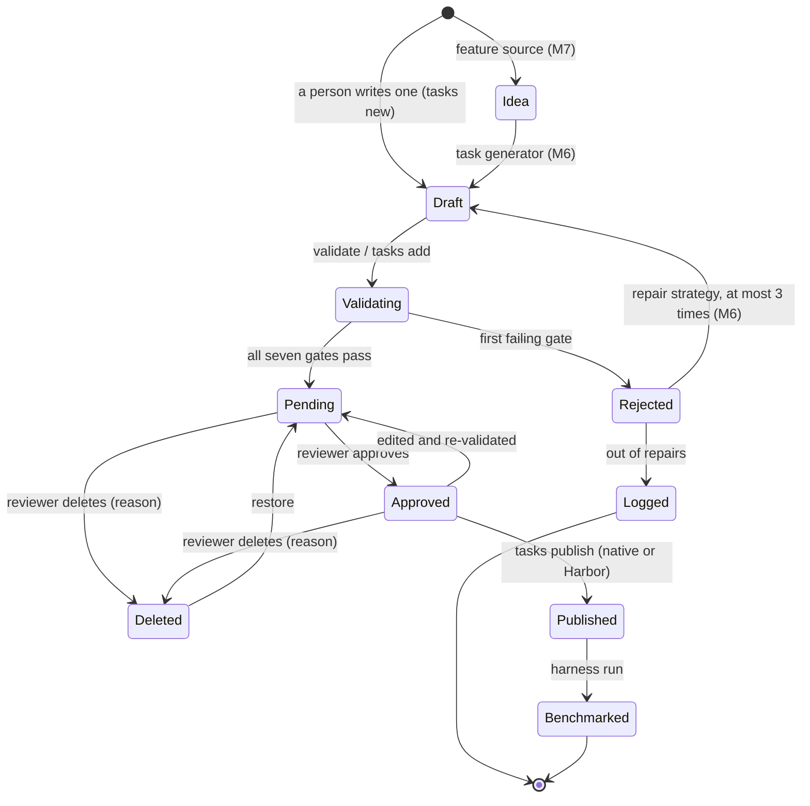

Today, drafts are written by people in a simple folder format (`task.json`,
`requirements.md`, `after/` with the changed source files, `tests/`). The
factory computes the reference diff from `after/` with git, so a hand-written
task never goes stale. Milestone M6 will produce the same `TaskDraft` from an LLM.

## 16. Reproducibility guarantees

| Source of variation | How it is pinned |
| --- | --- |
| Repo content | full commit SHA; synthetic history uses a fixed author and date |
| Environment | base image pinned by digest at inspect time (`sandbox.pin_base_image`); image tag = hash of commit, base image, setup commands and prelude version |
| Runtime | fixed `TZ`, `LANG`, `PYTHONHASHSEED`; no network |
| Test identity | stable string IDs from machine-readable reports |
| Task identity | deterministic `task_id` from repo, commit, title and number |
| Package content | deterministic files and checksums (timings live outside the checksum) |
| LLM output (M6) | responses cached by prompt hash, so reruns replay identically |

## 17. How it is tested

There are 183 tests. Unit tests use two small fixture repositories that are rich
enough to show real failure modes:

| Fixture | Contents |
| --- | --- |
| `toy_python_repo` (toyshop) | 6 modules with real dependencies, 28 tests incl. one slow and one switchable flaky test, README roadmap and TODO |
| `toy_node_repo` (textkit) | 4 modules, 22 node:test tests incl. slow and flaky, README roadmap and TODO |
| `tasks/python`, `tasks/node` | per repo: one good task, one broken task per reject code, and a "looks right but wrong" mutant |

Beyond the gates, tests cover the review flow (approve, delete without a reason
is refused, trash and restore, the interactive loop driven by scripted key
presses, edits that are re-validated or refused), human-authored tasks, the
harness (oracle 100%, noop 0%, a wrong agent graded `wrong_behaviour`, an agent
that edits an existing test to hide a regression is still caught, hidden files
absent from the agent sandbox), and the Harbor export run with Harbor's mounts.
`tests/test_hardening.py` covers what the review in round 4 found: a cheating
`conftest.py` (and `pytest.ini`, deleted tests, weakened tests, `pyproject.toml`
options) is undone before grading; a reference patch that edits a test file is
rejected; agent errors stop a run and keep assignments open; a package still
works after the original repo is deleted (harness and git branch both use
`repo.tar`); export never overwrites a reviewed package; a republish removes
deleted tasks; the baseline cache follows the test settings; and digest pinning.

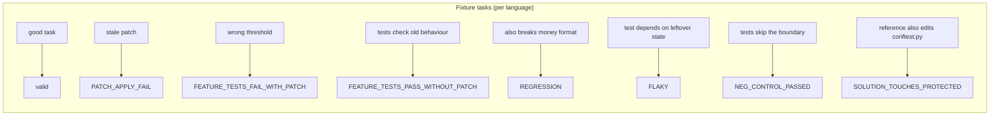

Docker tests are marked `docker` and skip with a clear message when Docker is
missing; `uv run pytest -m "not docker"` runs the rest in seconds.

## 18. Extending task-factory

| You want to… | Change |
| --- | --- |
| Support a new language | add one rule in `repo/inspector.py` (`RULES`), and one parser in `runner/parsers/` if its report format is new |
| Use the official package template | rewrite `packaging/writer.py` and `packaging/verify.py`; nothing else knows the layout |
| Use Podman instead of Docker | set `sandbox.docker_binary = "podman"` |
| Tune strictness | `gates.mutations`, `gates.stability_repeats`, `gates.max_known_failure_ratio` in `factory.toml` |
| Fix a detection mistake | override any `EnvConfig` field under `[env]` in `factory.toml` |
| Plug in an LLM provider (M6) | implement the `LLMClient` interface in `llm/` |
| Benchmark another coding agent | add `[harness.agents.NAME]` (install + run command) to `factory.toml`, or use `--agent command --cmd …` |
| Run on Harbor's agents | `factory tasks publish --format harbor --out DIR`, then `harbor run -p DIR -a <agent>` |

## 19. Roadmap

The first prompt-driven authoring path is available through `factory generate`. It connects directly to the configured model provider and uses the existing validator. The roadmap below describes the wider, automated pipeline.

| Milestone | Component | What it adds |
| --- | --- | --- |
| M6 | LLM client + task generator | requirements, reference patch and tests from a feature idea; the tests are written from the requirements only, without seeing the patch; targeted repair strategies per reject code |
| M7 | Feature source | ideas from docs, TODO/FIXME, issues, history and code gaps, each with evidence; filters for already-implemented, too large or unsafe ideas |
| M8 | Variation manager | rejects near-duplicates (text similarity, file overlap, identical normalized patches) and balances tags |
| M9 | Report generator | funnel, rejection breakdown, per-task gate table, variation table, cost, limitations |
| M10 | Orchestrator | `factory run` does every step in one command |
| M11 | Real runs | at least 10 valid, varied tasks on the organizers' repo, plus a second repo with no code change |
| M12 | Extras | demo script, video, deck (the solver benchmark is already built as the coding harness) |

The LLM provider is not chosen yet; the client stays provider-agnostic until
hackathon credits are known.

## 20. Glossary

| Term | Meaning |
| --- | --- |
| **Task package** | A folder with requirements, reference patch, hidden tests, environment and evidence |
| **Reference patch** | A unified diff that implements the task against the pinned commit |
| **fail_to_pass** | New tests that fail on the original repo and pass with the reference patch |
| **pass_to_pass** | Existing tests that passed before and must still pass |
| **Known failures** | Tests already failing at baseline; recorded and excluded |
| **Mutant** | A deliberately wrong variant of the reference patch |
| **Mutation score** | Mutants caught ÷ mutants run |
| **Gate** | One validation check (G0–G6) with its own fresh sandbox and log |
| **Sandbox** | An isolated working copy of the pinned repo (a container) |
| **Workdir** | The folder where every step keeps its JSON input and output |
| **Task store** | The folder of valid packages plus `.trash/` and the review log |
| **Review log** | Append-only record of every approve, delete, restore, edit and note |
| **Harness** | The tool that runs AI coding agents on tasks and grades them |
| **Oracle** | A harness agent that applies the reference patch; it must resolve every task |
| **resolved@k** | Share of tasks an agent solved in at least one of k attempts |
| **Harbor** | An open-source agent-evaluation framework whose task format we export |
| **Assignment** | A request in the review log that one agent + model attempt one task |
| **Solutions repo** | A clone of the task's repo where each passing AI solution is a commit on its own branch |
