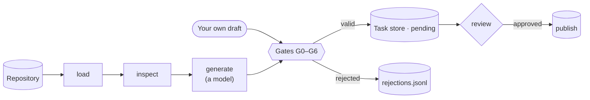

# Gated pipeline

Create tasks for your own repository and prove each one valid by running code.

## Overview



- Every step reads and writes JSON in the work folder, so a run can be stopped and resumed.
- A model may write requirements, patches and tests, but **only executed tests decide validity**.

## 1. Load

```sh
factory load --repo PATH_OR_URL_OR_ZIP [--commit SHA]
```

- Copies the repository into the work folder; the original is never modified.
- Pins one full commit SHA (a zip gets a deterministic synthetic history).
- Refuses a working copy with uncommitted changes to tracked files.

## 2. Inspect

```sh
factory inspect
```

- Detects the language from marker files ([Configuration](configuration.md#languages)).
- Picks the base image, setup commands and test command.
- Pins the base image by digest.
- Builds the image and runs the full test suite once (the **baseline**).
- Stops with `needs_manual_config` and the reasons when it cannot decide; fix it with `[env]` in `factory.toml`.

## 3. Write a task

### Generate with a model

```sh
factory generate --prompt "add a bulk discount for 10+ items" --model PROVIDER/MODEL [--file path]
```

- The model writes the requirements, the reference change and the hidden tests in separate requests.
- The draft then goes through every gate.
- From the terminal: `/generate-task …` ([Terminal](terminal.md)).

### Write your own

```sh
factory tasks new my-task          # creates workdir/drafts/my-task with a template
factory tasks add workdir/drafts/my-task
```

- A draft folder contains:

| File | Contents |
|---|---|
| `task.json` | Title, kind, tags |
| `requirements.md` | The requirements the solver will see |
| `after/` | The changed source files (the patch is computed with git) |
| `tests/` | The hidden test files |
| `solution.diff` | Optional: the patch itself, instead of `after/` |

- Hand-written tasks pass the same gates; they are recorded as `human (your name)`.

## 4. Validate: the seven gates

- Each gate runs in a fresh, offline container.
- The first gate that fails rejects the task with a code; the reason goes to `rejections.jsonl`.
- Order: G0, G1, G2, G3, G4, G6, G5 (the most expensive last).

| Gate | Checks | Failure code |
|---|---|---|
| **G0** Baseline | The original repository's tests pass | `BASELINE_FAIL` |
| **G1** Patch applies | The reference diff applies cleanly and touches no test or test-config file | `PATCH_APPLY_FAIL`, `SOLUTION_TOUCHES_PROTECTED` |
| **G2** Feature works | The new tests pass with the patch | `FEATURE_TESTS_FAIL_WITH_PATCH` |
| **G3** Tests need the feature | The new tests fail without the patch | `FEATURE_TESTS_PASS_WITHOUT_PATCH` |
| **G4** No regressions | Every existing test still passes | `REGRESSION` |
| **G6** Tests are strong | Deliberately wrong patches are caught | `NEG_CONTROL_PASSED` |
| **G5** Stable | Repeated runs give the same result | `FLAKY` |

- Run the gates on drafts or packages directly:

```sh
factory validate --tasks DIR      # drafts, or published packages (re-verification)
factory export                    # valid drafts go into the store as pending
```

### Mutation testing (G6)

- G3 proves the tests fail when the feature is **absent**; G6 proves they fail when it is **wrong**.
- Mutants change only lines the patch adds.

| Operator | Reference | Mutant |
|---|---|---|
| `empty` | the whole patch | no patch (reuses G3) |
| `flip_comparison` | `if qty >= MIN:` | `if qty > MIN:` |
| `drop_error_branch` | `raise ValueError(…)` | `pass` |
| `swap_arguments` | `g(a, b)` | `g(b, a)` |
| `hardcode_expected` | `return amount` | `return 900` |
| `revert_half` | two hunks | only the first hunk |

- Safety rules:
  - Skip comments, string literals, function and import lines.
  - Drop mutants identical to the reference or to each other.
- Choose operators with `gates.mutations`; the default is `empty`, `flip_comparison`, `drop_error_branch`.
- Known limit: an *equivalent* mutant (one that cannot change behaviour) survives and rejects a good task; the reject reason names it.

### Cost per task

| Work | Containers |
|---|---|
| G0 baseline | 1 per image, then cached |
| G1–G4 | 4 |
| G6 | 1 per mutant |
| G5 | 1 (with N repeats inside) |

- With the defaults (2 mutants, 1 repeat): about 7 containers per task; toy tasks validate in seconds.

## 5. Review

```sh
factory review                                   # one task at a time: a, d, s, i, p, t, g, e, q
factory tasks list [--status pending]
factory tasks show TASK_ID [--section patch|tests|gates|instruction]
factory tasks approve TASK_ID [--note "…"]
factory tasks delete TASK_ID --reason "requirements are vague"
factory tasks restore TASK_ID
factory tasks edit TASK_ID                       # unpack to a draft
factory tasks edit TASK_ID --apply --reason "…"  # re-validated, marked as a manual edit
factory tasks summary                            # counts, deletions with reasons, manual edits
```

- Review states and the log: [Concepts](concepts.md#review-states).

## 6. Publish

```sh
factory tasks publish --out submission/ [--format native|harbor] [--include-pending]
```

- Copies only approved tasks (unless `--include-pending`).
- Writes `review_summary.json`: deletions with reasons, human-authored tasks, manual edits.
- A republish removes tasks that are no longer approved.

## What kinds of tasks fit

| Area | Fits | Example that passed every gate | Does not fit |
|---|---|---|---|
| Features and bug fixes | Behaviour a test can check | Bulk discount on cart lines | — |
| Security | Flaws a test can demonstrate (injection, validation, path traversal) | Receipt line injection + SKU allowlist | Anything needing a network or live service |
| Scalability | Algorithmic cost in one process | Tag index measured as a timing ratio | Distributed scale |
| Design | API design visible in behaviour | Pluggable coupon rules | Pure refactors (G3 needs a failing test), visual or architecture design |

- Every hidden test must fail without the change, so put "guard" assertions inside a failing test.
- Timing-based tests also need correctness assertions (mutants rarely apply to pure speed-ups).
- Worked examples: [`examples/toyshop/`](../examples/toyshop/README.md).

## Exit codes

| Code | Meaning |
|---|---|
| `0` | Success |
| `1` | Pipeline failure |
| `2` | Bad usage or configuration |
| `3` | Environment problem (for example, Docker missing) |
| `4` | Ran, but no valid tasks |
