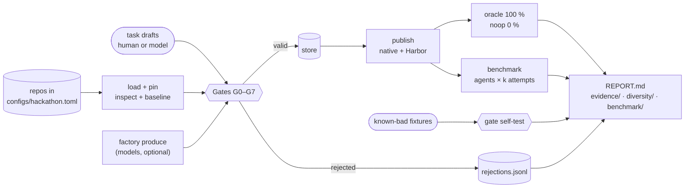

# Track 1 guide: one command, and where the evidence is

## Reproduce everything

```sh
uv sync
uv run factory pipeline configs/hackathon.toml
```

- Needs Docker (or Podman) and Node 22 for the JavaScript repository. No API key is needed to
  build and validate tasks; benchmarking a model needs that model's key (see below).
- The run is resumable: finished steps are skipped (`--force` redoes them). Pick steps with
  `--only` / `--skip`: `tasks`, `selftest`, `publish`, `sanity`, `benchmark`, `evidence`.
- No Docker? A smoke run without isolation: `uv run factory pipeline configs/dev-local.toml --backend local`.

## What one run does



| Stage | Command it runs | Output |
|---|---|---|
| Generate | `factory load`, `inspect`, `tasks add` per draft, `produce` (optional) | `workdir/pipeline/<repo>/tasks/` |
| Validate | the gates inside `tasks add`; `factory selftest` on known-bad drafts | `validation/` in each package, `selftest.json` |
| Publish | `factory tasks publish` (native and Harbor) | `submission/tasks/`, `submission/harbor/` |
| Sanity | `factory harness run --agent oracle` and `noop` | must be 100 % and 0 % |
| Benchmark | `factory harness run --agent A --model M --k K` | `workdir/pipeline/_bench/harness/` |
| Report | `factory evidence` | `submission/REPORT.md` and the folders below |

## Where each judging criterion is answered

| Criterion | Evidence | Mechanism |
|---|---|---|
| Implementation and repeatability (25 %) | `configs/hackathon.toml`, `submission/pipeline_run.json` | One command; every step a file-to-file `factory` command; pinned commits and base images by digest; deterministic task IDs and checksums; 300+ automated tests |
| Validity and validation evidence (25 %) | `submission/evidence/validation_matrix.csv`, `gate_selftest.json`, `rejections.jsonl`, each package's `validation/logs/` | Gates below; oracle/noop through the same grader the models use; known-bad drafts rejected with the expected code |
| Meaningful variation (20 %) | `submission/diversity/stats.json`, section 2 of `REPORT.md` | Two repositories and two languages; feature, behaviour-change, security and scalability tasks; S/M/L size tiers; multi-file changes; near-duplicate check |
| Original approach (15 %) | `docs/gated-pipeline.md`, `docs/reference-pipeline.md` | Mutation testing as a validity gate, a static spec-coverage gate, a self-testing validator, peer-repository research with a critic, a blind multi-model builder panel, egress allowlist |
| Practical impact and communication (15 %) | `submission/REPORT.md`, `submission/benchmark/` | Leaderboard (resolved@k, pass@1, partial credit), per-task solve matrix, failure modes including test tampering |

## The gates

| Gate | Proves | Reject code |
|---|---|---|
| G0 | The starting commit's whole suite passes | `BASELINE_FAIL` |
| G1 | The reference applies and touches no test or test config | `PATCH_APPLY_FAIL`, `SOLUTION_TOUCHES_PROTECTED` |
| **G7** | Every name the hidden tests import exists before the change or is named in the requirements (static, no container) | `UNDERSPECIFIED` |
| G2 | The hidden tests pass with the reference | `FEATURE_TESTS_FAIL_WITH_PATCH` |
| G3 | **Every** hidden test fails without it (fail-to-pass) | `FEATURE_TESTS_PASS_WITHOUT_PATCH` |
| G4 | No existing test breaks (pass-to-pass) | `REGRESSION` |
| G6 | Plausible-but-wrong versions of the reference are caught (10 operators) | `NEG_CONTROL_PASSED` |
| G5 | Identical results on repeated runs | `FLAKY` |

### Anti-shortcut design

- **Mutants model the mistakes coding models make:** off-by-one boundaries, a flipped comparison, an
  operator swapped, a condition inverted, `and`/`or` swapped, an error branch dropped, a hard-coded
  expected value, half the change missing, arguments swapped, no change at all. A task is kept only
  when its tests catch all of them (`min_mutation_score = 1.0`).
- **Mutants never touch docstrings, comments, strings, decorators or keyword flags**, so a surviving
  mutant means weak tests, not an equivalent mutant.
- **G7 stops ambiguous tasks:** a solver cannot be expected to guess `BULK_MIN_QTY` if the
  requirements never name it.
- **Grading cannot be gamed from the sandbox:** hidden tests and the reference never enter the
  agent's sandbox; test files and test configs the agent edits are restored before grading and
  reported as `tests_tampered`; the agent reaches only the model API.

## Benchmark models

Put agents in `configs/hackathon.toml`:

```toml
[pipeline.benchmark]
k = 2
agents = ["claude-code:anthropic/claude-sonnet-4-5", "task-factory:openrouter/qwen/qwen3-coder"]
```

- Export the provider key (`ANTHROPIC_API_KEY`, `OPENROUTER_API_KEY`, …), then
  `uv run factory pipeline configs/hackathon.toml --only benchmark --only evidence`.
- List agents: `uv run factory harness agents`. Details: [Coding harness](harness.md).

## Drive it from Claude Code

- `uv sync --extra mcp`, then `claude mcp add task-factory -- uv run --extra mcp factory-mcp`.
- Claude Code then runs the pipeline, writes new tasks and fixes rejected drafts through the gates:
  [Claude Code (MCP server)](mcp.md).
