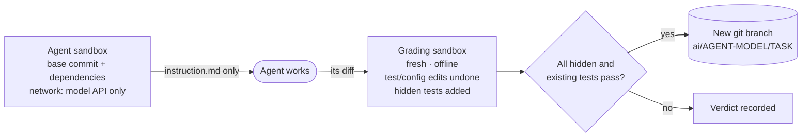

# Coding harness

Run AI coding agents on tasks, grade them with the hidden tests, and compare models.

## One attempt



- The agent sandbox never contains the hidden tests or the reference solution (checked before the agent starts).
- Before grading, every change the agent made to tests or test configuration is undone and reported (`tests_tampered`).
- Grading runs the hidden tests (`fail_to_pass`) and the full suite (`pass_to_pass`).
- Verdicts: [Concepts → attempt verdicts](concepts.md#attempt-verdicts).

## Running agents

```sh
factory harness agents                                        # list agents
factory harness run --agent oracle                            # must resolve 100%
factory harness run --agent noop                              # must resolve 0%
factory harness run --agent task-factory --model opencode/big-pickle [--k 3] [--workers 2]
factory harness run --agent command --cmd 'my-agent --task-file {instruction_file}'
```

| Option | Meaning |
|---|---|
| `--tasks DIR` | A package or folder of packages (default: the store) |
| `--task ID` | Only this task (repeatable, partial IDs allowed) |
| `--status` | Which tasks from the store: `approved`, `pending`, `all` |
| `--k N` | Attempts per task |
| `--workers N` | Attempts at the same time (default 1) |
| `--timeout S` | Agent time limit in seconds |
| `--use-host-auth` | Copy your stored login for that provider into the sandbox |
| `--no-branch` | Do not create git branches for passing solutions |

## Assignments

```sh
factory tasks assign TASK_ID --agent task-factory --model nvidia/…
factory tasks assignments            # what is waiting
factory harness work                 # run every open assignment
factory tasks assignments --all      # results, with the branch of each passing solution
```

- An assignment stays open after an `agent_error`, so it can be retried.

## Agents

| Agent | Runs | State |
|---|---|---|
| `task-factory` | The bundled Task Factory engine, headless | Verified with real models |
| `oracle` | Applies the reference patch | Verified |
| `noop` | Changes nothing | Verified |
| `command` | Any shell command (`--cmd`, `{instruction_file}` placeholder) | Verified |
| `claude-code` | `claude -p … --output-format json` | Preset |
| `codex` | `codex exec …` | Preset |
| `aider` | `aider --message-file …` | Preset |
| `mini-swe-agent` | `mini -y --exit-immediately …` | Preset |
| Your own | `[harness.agents.NAME]` in `factory.toml` | — |

- Agents with files (the engine) get them mounted read-only from a Docker volume; nothing is copied into images.
- Web tools are disabled for every run ([Security](security.md)).

## Models

| Provider | Example `--model` | Credentials |
|---|---|---|
| Zen (free models, rate limited) | `opencode/big-pickle`, `opencode/deepseek-v4.1-flash-free` | None for free models, or `TASK_FACTORY_API_KEY` |
| NVIDIA | `nvidia/<model id>` | `NVIDIA_API_KEY` |
| TokenRouter | `tokenrouter/<model id>` | `TOKENROUTER_API_KEY` |
| OpenRouter | `openrouter/<model id>` | `OPENROUTER_API_KEY` |
| AWS Bedrock | `amazon-bedrock/qwen.qwen3-coder-480b-a35b-v1:0` | AWS keys or `AWS_BEARER_TOKEN_BEDROCK` |

- `task-factory terminal models` lists the exact IDs your accounts can use.
- Only the provider's own variables are forwarded into the sandbox.
- The sandbox reaches only the hosts in `[harness] allowed_hosts`; add a provider's host there if needed.

## Solution branches

- Every resolved attempt becomes a commit on its own branch in `<workdir>/solutions/<repo>`:

```text
ai/<agent>-<model>/<task_id>

Task: <task_id>
Base commit: <full SHA>
Agent: task-factory · Model: <model> · Attempt 1
Hidden tests: 3/3 fail_to_pass passed, 28/28 pass_to_pass passed
```

- Test files the agent edited are not part of the commit.

## Scores

| Measure | Meaning |
|---|---|
| resolved@k | Share of tasks solved in at least one of k attempts |
| Pass rate | Share of attempts that resolved |
| Difficulty | Per task: `all` (every attempt solved it), `some`, `none`, or `error` (only agent errors) |
| Time, tokens, cost | When the agent reports them |

- A task no attempt solves gets a note in the review log: it may be unsolvable.
- A run stops after two agent errors in a row (an exhausted quota fails every task alike).

## Parallel runs

- `--workers N` (or `harness.workers`) runs N attempts at once.
- Each attempt has its own sandbox (2 CPUs, `sandbox.memory`); blocked hosts are recorded per sandbox.
- Default is 1: free models hit quota limits sooner when run in parallel.
- Measured: 8 oracle runs with 3 workers in 31 s; two model attempts side by side in ~4 min instead of ~8.

## Harbor export

- [Harbor](https://github.com/laude-institute/harbor) runs agents on tasks in its own layout.

```sh
factory tasks publish --format harbor --out harbor/
harbor run -p harbor/ -a oracle     # Mean 1.000
harbor run -p harbor/ -a nop        # Mean 0.000
```

- The Harbor verifier gives reward 1 only when every hidden test ran and passed and the full suite passes.
