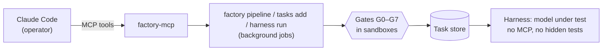

# Claude Code (MCP server)

Drive the whole factory from Claude Code: run the pipeline, write new tasks, push them through the
gates, review them and read the evidence. The connection uses the Model Context Protocol (MCP).



- **Claude Code is the operator, never the judge of validity.** A draft it writes becomes a task only
  when the executed gates pass it.
- **Never connect a model under test to this server.** The tools read hidden tests and reference
  solutions. Models under test run inside the harness sandbox, which has no MCP access.

## Install

```sh
uv sync --extra mcp                                   # adds the official MCP SDK
claude mcp add task-factory -- uv run --extra mcp factory-mcp
```

- To share the server with the team, copy `mcp.example.json` to `.mcp.json` (project scope).
- On Windows with the project inside WSL, run the server in WSL, so Windows `uv` never touches the
  Linux virtual environment:

```sh
claude mcp add task-factory -- wsl -d Ubuntu -- bash -lc "cd /mnt/d/path/to/task-factory && ~/.local/bin/uv run --extra mcp factory-mcp"
```

- Check it with `/mcp` in Claude Code. The server's instructions tell Claude the typical flows.

## Tools

| Tool | What it does |
|---|---|
| `factory_overview` | Repositories, tasks per review status, harness runs, evidence summary |
| `run_pipeline` | `factory pipeline configs/hackathon.toml` as a background job (`only`, `skip`, `force`, `backend`) |
| `job_status`, `list_jobs`, `cancel_job` | Follow background jobs (log tail, exit code) |
| `prepare_repo` | Pin a repository and build its environment (load + inspect) |
| `repo_context` | Path of the pinned clean copy, language, test command, file list |
| `scaffold_task` | Create an empty draft folder for Claude to fill with its file tools |
| `validate_draft` | Run every gate on a draft; a valid one enters the store (pending) |
| `gate_report` | Every gate's details, mutants, survivors and log paths for a task or rejected draft |
| `list_tasks`, `show_task` | Browse the store: instruction, reference patch, hidden tests, gates |
| `review_task` | Approve, or delete with a reason (disclosed in the report) |
| `run_benchmark` | Run an agent on published tasks (oracle, noop, task-factory, claude-code, codex, …) |
| `build_evidence`, `read_report` | Recompute and read `REPORT.md` and the evidence files |

- Prompt `author_task(feature)`: a step-by-step brief for writing one realistic task and getting it
  through every gate without weakening its tests.

## Example session

```text
> Use task-factory: write a task for toyshop that adds gift cards which can pay part of an order.

  repo_context → reads toyshop/pricing.py, cart.py, receipt.py
  scaffold_task("gift-cards", "Gift cards as partial payment")
  writes requirements.md, after/toyshop/giftcards.py, after/toyshop/pricing.py, tests/tests/test_gift_cards.py
  validate_draft(...) → job_status → G6 FAIL: mutant flip_comparison#1 survived
  gate_report → the tests never use a card worth exactly the order total
  adds that boundary test → validate_draft → valid (pending)
  show_task → waits for your approval → review_task(approve)
```

## Files

- Jobs: `workdir/.mcp-jobs/<job_id>.json` (command, exit code) and `.log` (full output).
- The server's working folder is the project root (`TASK_FACTORY_HOME` overrides it).
