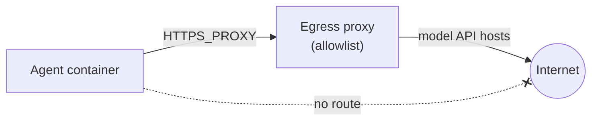

# Security model

How tasks stay valid and agents stay honest.

## Isolation

| Sandbox | Network | Contents | Limits |
|---|---|---|---|
| Validation (gates) | None | Repository + candidate change | 2 CPUs, `sandbox.memory`, 512 processes |
| SWE extraction | None | Repository + PR tests ± PR code | Same, `--memory` |
| Agent | Model APIs only (allowlist) | Repository at the base commit, `instruction.md` | Same |
| Grading | None | Agent's change + hidden tests | Same |

- Every container runs as a non-root `factory` user when the image has one.
- Timeouts kill every process in the container.
- Images are pinned by digest; environments are rebuilt identically anywhere.

## What the agent can never see

| Risk | Protection |
|---|---|
| Hidden tests | Never written into the agent sandbox; a leak check fails the attempt if they appear |
| Reference solution | Never written into any agent sandbox |
| The fix in git history | Each image starts a fresh history with one `base` commit |
| The public fix online (SWE tasks) | Web tools are off; the network reaches only the model APIs |
| A newer, fixed release of a dependency | Installs are pinned to the merge date; package indexes are unreachable |

## Egress allowlist

- The agent container joins `factory-egress`, an internal Docker network with no route out.
- Its only way out is a small proxy container (`factory/harness/egress_proxy.py`):
  - HTTPS `CONNECT` on port 443 only;
  - hosts must match `[harness] allowed_hosts` (fnmatch patterns);
  - runs non-root, read-only, 128 MB, no capabilities.
- Every refusal is logged with the client's address and recorded per attempt (`egress_blocked`).
- Defaults: Zen (`opencode.ai`, `*.opencode.ai`), NVIDIA, TokenRouter, OpenRouter, Anthropic, OpenAI, Groq, Bedrock.
- Turn it off with `[harness] egress = "open"` (not recommended for benchmarks).
- Remove the proxy: `docker rm -f $(docker ps -aq --filter label=factory-egress=1)`.

## Web tools are off

- Task Factory engine: `webfetch` and `websearch` are denied through its configuration.
- Claude Code: `--disallowedTools WebFetch,WebSearch`.

## Cheating is blocked

- Before grading, changes to tests and test configuration (`conftest.py`, `pytest.ini`, `pyproject.toml`, `package.json`, Jest/Vitest config, …) are undone; edited and deleted files are restored, new ones removed.
- A reference patch that touches those files is rejected at G1.
- API keys never appear on a command line or in logs.

## Evidence

- On `pallets/click`, with open network, a free model searched the web in 5 of 8 attempts and once downloaded the pull request's diff.
- With the allowlist, the same task scored 4/10 instead of 10/10, and the model's attempt to reach `github.com` was refused and recorded.
- An audit of 23 earlier gated-pipeline attempts found no internet use.

## Known open risks

| Risk | Status | Planned fix |
|---|---|---|
| The provider login is copied into the agent sandbox, where the repository's own code also runs | Open | Host-side model proxy that adds the key itself |
| A model API that browses the web on its own | Open | Avoid such models and plugins for benchmarks |
| Public pull requests in training data | Mitigated by `--since` | Prefer private repositories |
| Requirements that leak the solution (generated tasks) | Open | Quality check on generated requirements |
