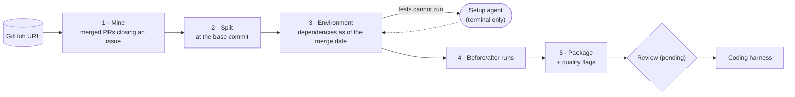

# SWE miner

Turn a GitHub repository's history into SWE-bench style tasks.

## Overview



- Written in TypeScript (`swe/`), Node built-ins only: nothing to install besides Node 22.18+.
- Uses your GitHub CLI login (`gh auth login`).
- Packages have the same layout as the gated pipeline, so review, the harness and Harbor export work unchanged.
- No gates G0–G6 run here: a task is as strong as the project's own tests (see [Limitations](#limitations)).

## Usage

```sh
node swe/cli.ts mine https://github.com/OWNER/REPO [options]
node swe/cli.ts funnel https://github.com/OWNER/REPO     # how many PRs reached each step
node swe/cli.ts export https://github.com/OWNER/REPO     # rewrite swe-bench.jsonl
```

| Option | Default | Meaning |
|---|---|---|
| `--max N` | `10` | Candidates to process |
| `--scan N` | `200` | Pull requests to look at, newest first |
| `--since DATE` | — | Only PRs created after this date (limits training-data contamination) |
| `--out DIR` | `~/.local/state/task-factory/swe/<owner>-<repo>` | Where the store goes |
| `--retry` | off | Process PRs that were dropped before again |
| `--memory SIZE` | `2g` | Sandbox memory limit |
| `--workers N` | `1` | PRs processed at the same time |
| `--json` | off | JSON events on stdout (used by the terminal) |

- Accepted URL forms: `https://github.com/o/r`, `git@github.com:o/r.git`, `o/r`.
- From the terminal: `/swe URL [n]` and `/swe-tasks` ([Terminal](terminal.md)).

## How it works

### 1. Mine

- Reads merged pull requests through `gh api graphql`, newest first.
- A pull request is a **candidate** when it:
  - closes at least one issue (`closingIssuesReferences`);
  - changes at least one test file and at least one other file;
  - changes at most 100 files.
- Test files are: shared test folders (`tests/`, `test/`, `testing/`, `specs/`, `__tests__/`), `conftest.py`, and the project's pytest `python_files` patterns (default `test_*.py`, `*_test.py`).

### 2. Split at the base commit

- Fetches `refs/pull/N/head`.
- **Base commit** = merge-base of the PR head and its base branch.
- Changes on test paths → **hidden tests** (full file contents after the PR).
- Everything else → **reference patch** (including docs and changelog, like SWE-bench).
- **Problem statement** = the linked issues' titles and bodies, HTML comments removed; issue comments are not included.

### 3. Build the environment

| Choice | Rule |
|---|---|
| Python version | The newest one current when the PR merged; higher if `requires-python` says so |
| Dependencies | `uv pip install --exclude-newer <merge date>`: versions that existed then |
| What is installed | The project with its test extra (`test`, `tests`, `testing`, `dev`) or PEP 735 test group, `requirements*.txt`, pytest |
| Base image | `python:<version>-slim`, pinned by digest |
| Image | Same Dockerfile and tag as the Python side, so the harness reuses it |

- If the tests cannot run (no test passes even with the fix), the **setup agent** is asked:
  - only from the terminal (`/swe`), using the selected model in a session with every tool denied;
  - it reads the build files and the error, and proposes up to eight setup commands;
  - the commands run inside the container build, never on the host.

### 4. Extract the hidden test lists

| Run | Contents |
|---|---|
| Before | Base + hidden tests, no fix |
| After #1 | Base + hidden tests + reference patch |
| After #2 | The same again (flakiness check) |
| Full suite | Base + reference patch, every test (the harness grades `PASS_TO_PASS` here) |

- **FAIL_TO_PASS:** passes in both after-runs, does not pass before.
- **PASS_TO_PASS:** passes before, in both after-runs and in the full suite.
- Tests that differ between the two after-runs are **flaky** and left out.
- Skipped tests and tests still failing after the fix are left out.
- All runs are offline, with memory, CPU and process limits.

### 5. Package

- Writes the package, `swe.json` and a line in `swe-bench.jsonl` (SWE-bench fields).
- Computes **quality flags** for reviewers (nothing is dropped because of them):

| Flag | Meaning |
|---|---|
| `tests_use_names_not_in_issue` | The hidden tests call a new function or class the issue never names |
| `short_problem_statement` | The issue is too short to act on |
| `large_change` | The reference patch changes more than 400 lines |

## Outputs

```
~/.local/state/task-factory/swe/<owner>-<repo>/
├── repo/              Full clone (reused)
├── tasks/             Packages (pending review) + .review/log.jsonl
├── prs/<n>.json       Each PR's outcome: task, or dropped with a reason
├── mined.json         PRs scanned and why they were skipped
├── harness/           Results of agent runs on these tasks
└── swe-bench.jsonl    Every task in SWE-bench format
```

- Use the store with any `factory` command via `--workdir`:

```sh
W=~/.local/state/task-factory/swe/pallets-click
factory tasks list --workdir $W
factory harness run --agent oracle --tasks $W/tasks --workdir $W
```

## Drop reasons

| Reason | Meaning |
|---|---|
| `no_linked_issue` | The PR closes no issue |
| `no_test_change` / `only_test_change` | Tests and code are not both changed |
| `too_many_files` | More than 100 files changed |
| `deletes_test_file` | Hidden tests can only add or change files |
| `binary_test_file` | A test file is not UTF-8 text |
| `not_python` | No Python project files at the base commit |
| `env_failed` | The tests do not run, even with the setup agent |
| `oom` | A test run hit the memory limit (`--memory`) |
| `patch_apply_fail` | The reference patch does not apply |
| `no_fail_to_pass` | No test fails before the fix and passes after it |

## Results on real repositories

| Repository | Scanned | Candidates | Tasks | Oracle | Empty patch |
|---|---|---|---|---|---|
| `pallets/click` | 52 PRs | 8 | 8 | 8/8 resolved | 0/8 |
| `python-humanize/humanize` | 56 PRs | 3 | 2 | 2/2 resolved | 0/2 |

## Limitations

- Python repositories only.
- No mutation gate: weak project tests make weak tasks.
- Task kind comes from labels (most tasks show as `bugfix`).
- Public pull requests may be in a model's training data; prefer `--since`.
- One Docker image per base commit (~450 MB).
- Full list: [decisions.md](decisions.md#limitations).
